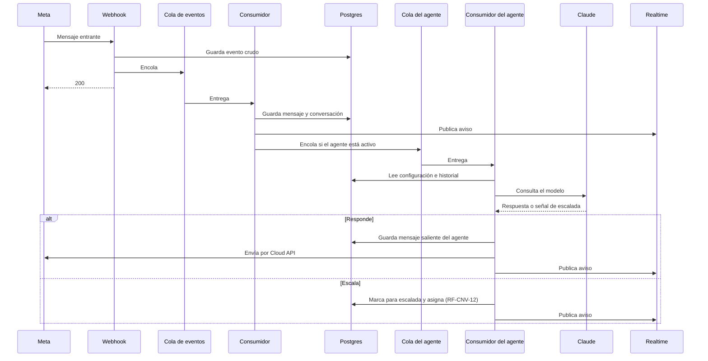

# ADR-014: Agente de IA configurable por negocio

- **Estado:** Aprobada
- **Fecha:** 2026-10-15 (aprobada el 2026-10-15)
- **Decisores:** Franco, Anthony
- **Requisitos relacionados:** RF-CNV-11, RF-CNV-12, RF-CNV-13, RF-CNV-16, RF-MET-02, RF-TRV-01, RF-TRV-02, RF-TRV-07, RF-AUT-07, RF-CFG-03
- **Depende de:** ADR-001, ADR-003, ADR-005, ADR-006, ADR-007, ADR-008, ADR-012
- **Condiciona a:** ADR-013 (métricas), y el documento de arquitectura

## Contexto

Franco y Anthony deciden el 2026-10-15 incorporar al MVP un **agente de IA configurable por negocio**, que atiende las conversaciones en primera línea, escala a un asesor cuando no sabe responder o cuando se lo piden, y puede cerrar conversaciones. Las demás integraciones y automatizaciones quedan para después del MVP.

### Este es un cambio de alcance, no un hueco de diseño

Hay que registrarlo con claridad, porque contradice una exclusión explícita. `docs/01_definicion_mvp_v2.2.md` §6, "Fuera del MVP", dice:

> - Agentes de IA y constructor de automatizaciones. **La arquitectura se diseña para incorporarlos después.**

La decisión de hoy revierte esa exclusión. El documento de definición del MVP debe actualizarse en consecuencia (ver "Consecuencias").

### La objeción que se registró y se desestimó

Al plantear la decisión se advirtió que el agente no cabía en el calendario sin sacar algo a cambio, y se ofrecieron tres caminos: entrar recortando alcance equivalente, diseñar ahora y construir después, o entrar sin recortar asumiendo el riesgo. **Franco eligió entrar sin recortar nada.**

La advertencia queda registrada aquí porque es el tipo de cosa que conviene tener escrita en la revisión del 16 de noviembre, no para reabrir la decisión:

- El cronograma ya estaba marcado como ajustado antes de esto: 44 requisitos de consola más 63 del CRM en siete semanas con dos personas a tiempo parcial (ADR-002).
- De las tres formas de activación posibles, la elegida —agente en primera línea— es la más invasiva: cambia el momento en que se dispara la asignación (`RF-CNV-12`), agrega un escritor más al camino de salida (ADR-012) y altera el cálculo de un indicador (`RF-MET-02`).

**La mitigación no es recortar ahora, sino dejar el repliegue preparado.** La sección "Orden de repliegue" de este ADR define qué se apaga y en qué orden si el 16 de noviembre el avance no alcanza. Un repliegue decidido hoy, con calma, es mejor que uno improvisado en noviembre.

### Lo que cambia el perfil de riesgo del proyecto

Hasta este ADR, **el contenido de las conversaciones nunca salía del sistema.** Era una propiedad fuerte: `RF-TRV-07` lo mantenía fuera de la consola, los registros y las métricas, y ADR-010 lo mantenía fuera de las URL públicas.

Un agente de IA envía el contenido de las conversaciones a un tercero. Con clínicas estéticas y odontologías en el segmento inicial, ese contenido incluye **datos de salud, que la Ley 1581 de 2012 trata como datos sensibles**, y donde el negocio es el responsable del tratamiento y Numi el encargado (`CLAUDE.md` §8).

Esto no bloquea la decisión, pero sí obliga a tres cosas que el ADR resuelve abajo: un arreglo de tratamiento de datos verificado con el proveedor, consentimiento del negocio antes de activar, y la posibilidad de operar sin agente.

## Investigación

### Precios de Anthropic, verificados

Fuente: documentación oficial de la API de Claude, consultada el 2026-10-15. Precios por millón de tokens.

| Modelo | Identificador | Entrada | Salida | Contexto |
| --- | --- | --- | --- | --- |
| Claude Haiku 5.5 | `claude-haiku-5-5` | 0,10 USD | 0,50 USD | 1M |
| Claude Sonnet 5.5 | `claude-sonnet-5-5` | 2,00 USD | 10,00 USD | 1M |
| Claude Opus 5.5 | `claude-opus-5-5` | 4,00 USD | 20,00 USD | 1M |

**Advertencia sobre estos precios.** Se mueven rápido: **reconfirmar antes de fijar un plan de cobro a los clientes.**

### Tratamiento de los datos por Anthropic, verificado

Fuentes: [Términos comerciales de Anthropic](https://www.anthropic.com/legal/commercial-terms) y la [documentación oficial de retención de datos de la API](https://platform.claude.com/docs/build-with-claude/api-and-data-retention), consultadas el 2026-10-15.

| Hecho | Detalle |
| --- | --- |
| **Entrenamiento** | Los términos comerciales prohíben a Anthropic usar el contenido del cliente para entrenar modelos. **No es una opción que haya que desactivar: es la condición contractual por defecto** |
| **Retención por defecto** | El contenido de las conversaciones **no se retiene por defecto**. Solo se guarda lo técnicamente necesario para que una función opere, con el menor tiempo de vida posible |
| **Retención cero (ZDR)** | Anthropic no almacena los mensajes ni las respuestas una vez devuelta la respuesta. **Se solicita al equipo de ventas** y se habilita por organización |
| **Preparación para HIPAA** | Alternativa a ZDR para organizaciones que tratan información de salud. Aplica cifrado, controles de acceso y registro de auditoría a lo largo del ciclo de vida del dato |
| **Excepción de retención** | Contenido marcado por las políticas de uso y órdenes legales se conservan en cualquier arreglo |

**Hallazgo que cambia el plan: la preparación para HIPAA se habilita por autoservicio.** La documentación es explícita: *"Eligible organizations can review and execute the BAA and enable HIPAA readiness directly from the Claude Console"*, y *"HIPAA readiness controls are applied to your organization as soon as you accept"*. El procedimiento es: consola → Data retention (`platform.claude.com/settings/privacy`) → tarjeta de HIPAA compliance → descargar y aceptar el BAA → **efecto inmediato**.

Esto importa porque **elimina una dependencia externa de calendario.** La documentación también dice cuál de los dos arreglos corresponde aquí: *"If your organization handles PHI, HIPAA readiness is the arrangement to use; you do not also need ZDR."* Las conversaciones de clínicas estéticas y odontologías contienen información de salud, así que **el arreglo correcto es la preparación para HIPAA, no ZDR.**

Tres advertencias de la misma documentación que condicionan el diseño:

1. **Una vez habilitada, la preparación para HIPAA es permanente** y no la puede desactivar un administrador. Es una decisión de una sola dirección.
2. **Las funciones en beta y la ejecución de código no están cubiertas.** La API devuelve un error 400 si una petición usa una función no elegible. El diseño de este ADR usa solo el endpoint de mensajes, que sí está cubierto.
3. **No incluir información de salud en los esquemas JSON** de salidas estructuradas: se almacenan en caché aparte y no reciben las mismas protecciones. Si se usan salidas estructuradas para la señal de escalada, el esquema lleva nombres de campo genéricos, nunca datos del contacto.

### Costo estimado por conversación

Con el volumen de `arquitectura.md` §1.1 —500 conversaciones por negocio al mes— y el supuesto de que el agente atiende los primeros intercambios antes de escalar:

| Concepto | Estimación |
| --- | --- |
| Tokens de entrada por respuesta (configuración del negocio más historial) | ~2.000 |
| Tokens de salida por respuesta | ~150 |
| Respuestas del agente por conversación antes de escalar | ~4 |
| Tokens por conversación | ~8.600 |
| **Costo por conversación con Claude Haiku 5.5** | **~0,0006 USD** |
| **Costo mensual, 20 negocios × 500 conversaciones** | **~6 USD** |
| **Costo mensual con Claude Sonnet 5.5** | **~110 USD** |

Dos conclusiones. **Con Haiku el costo es despreciable** frente a los 30 USD de infraestructura ya comprometidos. **Con Sonnet, el agente pasa a ser el componente más caro del sistema** y cuadruplica el costo total. La elección de modelo es, por tanto, una decisión de costo además de una de calidad.

**Recomendación: empezar con Claude Haiku 5.5** y medir la tasa de escaladas (`RF-MET-09`) durante el piloto. Subir de modelo es un cambio de una línea de configuración; es reversible y se decide con datos en lugar de por anticipado. El almacenamiento en caché de la parte estable del prompt —la configuración del negocio, que no cambia entre mensajes— reduce todavía más el costo de entrada.

## Opciones consideradas

### Opción A: El agente responde dentro del consumidor de la cola

El consumidor de ADR-005, tras guardar el mensaje entrante, consulta al modelo y envía la respuesta.

- **Ventajas:** reutiliza el camino ya construido; el agente responde rápido; no agrega piezas de infraestructura.
- **Desventajas:** alarga el procesamiento del evento, que ADR-005 quería corto; un fallo o una lentitud del proveedor de IA afecta al procesamiento del mensaje entrante, que es lo que `RF-TRV-02` protege; el reintento del lote de la cola podría reenviar una respuesta ya enviada al contacto.
- **Esfuerzo, costo y riesgo:** esfuerzo bajo. Riesgo **alto**: acopla el requisito más duro del sistema a un proveedor externo lento.

### Opción B: El agente es un consumidor propio, con su propia cola

El consumidor de ADR-005 guarda el mensaje y publica un evento; una cola aparte dispara al agente, que consulta al modelo y envía por el mismo camino de salida de ADR-012.

- **Ventajas:** **el procesamiento del mensaje entrante no depende del proveedor de IA**; un fallo del agente no pone en riesgo `RF-TRV-02`; los reintentos del agente son independientes de los del mensaje; el agente puede ser lento sin consecuencias para la bandeja; se apaga sin tocar el camino de entrada.
- **Desventajas:** una cola más que configurar y observar; el mensaje del agente tarda un poco más en salir; hay que resolver la idempotencia del envío del agente por separado.
- **Esfuerzo, costo y riesgo:** esfuerzo medio. Costo: incluido en las operaciones de Queues ya contratadas (ADR-005). Riesgo bajo.

### Opción C: El agente responde de forma síncrona al recibir el webhook

- **Ventajas:** la respuesta más rápida posible.
- **Desventajas:** **inviable.** ADR-005 fija que el webhook valida la firma, guarda, encola y responde 200, y nada más. Llamar a un modelo dentro de esa invocación arriesga el tiempo de respuesta a Meta, que es exactamente lo que `RF-TRV-02` no permite.
- **Descartada** por contradecir una decisión aprobada.

## Decisión

**Opción B: el agente es un consumidor propio, detrás de su propia cola.**

Razón, en orden de peso:

1. **`RF-TRV-02` no se pone en riesgo por una función nueva.** No perder mensajes entrantes es una de las tres invariantes absolutas del sistema (`arquitectura.md` §1.4). El agente es una función de producto valiosa, pero no está al mismo nivel: **si hay que elegir entre que el agente responda y que un mensaje no se pierda, no hay dilema.** La separación en una cola propia convierte esa prioridad en estructura, no en intención.

2. **El proveedor de IA es la pieza más lenta y menos predecible del sistema.** Una llamada a un modelo tarda segundos, no milisegundos, y puede fallar o limitar la tasa. Acoplarla al camino que Meta castiga con reintentos sería el error de diseño más caro disponible.

3. **Se apaga sin cirugía.** Si el agente hay que desactivarlo —por calendario, por costo o porque un cliente no lo quiere— se deja de consumir la cola y el sistema vuelve exactamente al comportamiento de ADR-005 y ADR-012. Esto es lo que hace posible el orden de repliegue.

### Cómo funciona

### Qué fija esta decisión para el diseño

**1. El agente es un escritor más, y usa el camino de salida existente.**

`arquitectura.md` y ADR-008 ya registran dos escritores: el consumidor de la cola y la API en el camino de salida. **El agente es el tercero**, y publica avisos de tiempo real con la misma función única que los otros dos (ADR-008, regla 4). No se construye un segundo camino hacia Meta: el agente reutiliza la lógica de envío de ADR-012, incluida la verificación de la ventana de 24 horas y el tratamiento de los errores de Meta.

**2. El agente nunca envía fuera de la ventana de 24 horas.**

`RF-CNV-08` aplica igual al agente que a una persona. Como el agente responde a un mensaje entrante recién llegado, la ventana estará abierta en la práctica totalidad de los casos — pero la verificación se hace igual, porque un evento reprocesado tarde podría caer fuera.

**3. Idempotencia del envío del agente.**

ADR-012 señaló el problema: en el camino de salida **no hay identificador de Meta antes de enviar**, así que no se puede deduplicar como en la entrada. Para una persona, la protección es que el reintento es manual. **El agente no tiene esa protección**, porque su cola reintenta sola.

La solución: **una clave de unicidad por `(organization_id, conversation_id, inbound_message_id)`** en los mensajes generados por el agente. Antes de llamar al modelo, el consumidor inserta la fila de intención con esa clave; si ya existe, el evento se descarta sin llamar al modelo ni enviar. Así un reintento de la cola no produce una segunda respuesta al contacto, que es el peor fallo visible posible de esta función.

**Qué pasa si el envío falla después de insertar la fila** *(precisado el 2026-10-16)*. La fila de intención se inserta antes de llamar al modelo, así que un reintento la encuentra y descarta. Si el envío a Meta falló —o expiró, el caso incierto de ADR-012—, descartar sin más dejaría al contacto **sin respuesta y en silencio**. Por eso lo que decide no es la existencia de la fila, sino **su estado**:

- La fila de intención se descarta en el reintento **solo si ya llegó a un estado final** —enviada, o escalada—. Es el caso normal: el trabajo ya se hizo.
- Si la fila sigue en un estado intermedio, el reintento **la retoma** en lugar de descartarla, sin volver a llamar al modelo si ya hay respuesta guardada.
- **El caso incierto de ADR-012 no se reintenta**: el agente no puede decidir, como sí hace un asesor, si vale la pena arriesgar un duplicado. La conversación **escala a una persona**, que ve el historial y decide. Es coherente con el punto 10: ante lo que el agente no puede resolver, responde una persona.

**4. Una organización suspendida no tiene agente activo.**

`RF-CNV-16` y `RF-AUT-07`: la suspensión se verifica al enviar. El agente pasa por la misma verificación que un asesor en ADR-012, paso 1. Los mensajes entrantes se siguen guardando; el agente simplemente no responde.

**5. El aislamiento aplica igual.**

El consumidor del agente usa el rol `app_worker` de ADR-006, con el contexto de organización del evento. **La configuración del agente de una organización nunca puede llegar a la conversación de otra**, y esto entra en las pruebas automáticas de aislamiento de `RF-TRV-01`. Es un caso nuevo a cubrir: una configuración mal filtrada haría que el agente de la clínica A respondiera con los precios de la clínica B.

**6. Qué se envía a Anthropic, y qué no.**

| Se envía | No se envía |
| --- | --- |
| La configuración del agente de esa organización | El nombre del contacto |
| El historial reciente de **esa** conversación | El teléfono del contacto |
| El mensaje entrante actual | Archivos adjuntos (el MVP no los envía al modelo) |
| | Datos de otras conversaciones o de otros negocios |

**El identificador del contacto no viaja.** El modelo recibe el texto de la conversación, no la identidad de quien escribe. Es una reducción barata de la superficie: si el contenido ya es sensible, al menos no se envía asociado a un nombre y un teléfono.

**6a. El agente ante entrada adversaria.**

*(Agregado el 2026-10-16 tras la revisión independiente. Este ADR aislaba bien el agente —cola propia, repliegue limpio, no toca `RF-TRV-02`— pero no decía nada sobre su comportamiento ante entrada hostil o anómala. El agente es la única pieza del sistema que **actúa sobre texto que escribe un desconocido**: el contacto no está autenticado, no tiene contrato con Numi y puede escribir lo que quiera.)*

**El texto del contacto es dato, nunca instrucción.** Es la regla que ordena el resto. El agente puede enviar mensajes a WhatsApp (punto 1) y cerrar conversaciones (punto 11); un contacto que logre que el modelo trate su mensaje como instrucción obtiene esas dos capacidades. Lo que se hace para evitarlo:

- **La configuración del negocio va en las instrucciones del sistema; el mensaje del contacto va como contenido del turno del usuario, delimitado y marcado como no confiable.** Nunca se concatenan en un mismo bloque de texto.
- **La configuración del negocio es confidencial.** Si el contacto pide ver las instrucciones, los precios internos o la configuración, el agente no los revela: se tratan como contexto operativo, no como información publicable.
- **El agente no tiene herramientas.** No ejecuta acciones por decisión del modelo: responde texto, o indica que escala. Cerrar y escalar son decisiones del **consumidor**, tomadas sobre la salida del modelo según las reglas del punto 10, no acciones que el modelo invoque por su cuenta. Esto acota el daño de una inyección exitosa a "el agente dijo algo inadecuado", que es recuperable, en lugar de "el agente hizo algo", que no siempre lo es.
- **La salida se valida antes de enviarse a Meta:** longitud acotada y, ante una respuesta vacía o malformada, se escala en lugar de enviar.

**Tope de turnos consecutivos del agente.** El punto 11 establece que una conversación cerrada **se reabre sola si el contacto vuelve a escribir**, y cada mensaje entrante encola al agente. La clave de idempotencia del punto 3 impide que un *reintento* duplique una respuesta, pero **no acota un intercambio largo**, porque cada vuelta trae un `inbound_message_id` nuevo y legítimo. Frente a un contestador automático del otro lado, o a alguien que decide jugar con el agente, eso es un intercambio que no termina y que se factura entero.

**El agente responde como máximo 10 veces consecutivas sin intervención humana en una conversación.** Alcanzado el tope, escala a un asesor por la vía del punto 10. El contador se reinicia cuando una persona escribe en la conversación. Diez es holgado para la atención comercial que describe el punto 9 —una consulta, respuesta, aclaraciones, cierre— y corta en seco el caso patológico.

**Tope de gasto por organización.** El costo estimado de la sección de investigación (unos 6 USD al mes) supone uso normal. No hay nada entre ese supuesto y la factura: un contacto que envíe mil mensajes produce mil llamadas al modelo, pagadas por Numi, y el negocio no asume ese costo. Se fija:

- **Un tope de mensajes del agente por organización y por día**, configurable, con un valor por defecto prudente para el piloto. Alcanzado el tope, el agente deja de responder y **las conversaciones escalan a asesores** — el mismo comportamiento que cuando Anthropic está caído, que ya está diseñado y probado.
- **El tope que se alcanza se registra y se alerta** (ADR-011). Un negocio que lo alcanza a diario necesita otro límite o es un caso de abuso; las dos cosas se quieren ver.

**La verificación de la suspensión ocurre antes de llamar al modelo.** El punto 4 dice que el agente pasa por la verificación de ADR-012 paso 1, que ocurre **al enviar**. Tomado literalmente, una organización suspendida ya habría pagado la llamada y —lo que importa más— **su contenido ya habría viajado a un tercero**. El consumidor verifica el estado de la organización y que el agente esté activo **al empezar a procesar el evento**, antes de cualquier llamada externa. La verificación de ADR-012 al enviar se mantiene como segunda red.

**7. Retención cero obligatoria antes de usar datos reales.**

**No se conecta un cliente real hasta que la preparación para HIPAA esté habilitada** en la organización de Anthropic. Durante el desarrollo se trabaja con datos de prueba. Es una condición, no una recomendación.

A diferencia de lo que habría exigido otro proveedor, **esto no es una dependencia externa de calendario**: se habilita por autoservicio desde la consola y tiene efecto inmediato. La tarea es descargar y aceptar el BAA como representante legal de la empresa, lo que **sí requiere una decisión de Franco y Anthony**, porque es permanente y no se puede revertir desde la consola.

Dos consecuencias prácticas que la documentación impone y que el diseño ya cumple:

- **Solo se usa el endpoint de mensajes**, que es elegible. Si una petición incluyera una función no cubierta —ejecución de código, por ejemplo— la API devuelve un error 400 en lugar de procesarla. Es una red de seguridad útil: el error es visible, no silencioso.
- **Ningún dato del contacto va en un esquema JSON.** Si se usan salidas estructuradas para la señal de escalada, el esquema lleva nombres genéricos. Los esquemas se almacenan en caché aparte y no reciben las protecciones de la información de salud.

**8. El contacto debe saber que habla con un agente.**

El agente se presenta como tal en su primer mensaje de cada conversación. No es solo buena práctica: es lo que evita que un paciente crea que un humano le confirmó algo clínico. El nombre y el tono son configurables (punto 9), pero **que se identifique como agente no lo es**.

**9. Qué configura cada negocio.**

Decidido por Franco y Anthony. Todo vive en una tabla por organización, editable desde el CRM por el administrador:

| Campo | Qué es |
| --- | --- |
| **Activado** | Interruptor por organización. **Apagado por defecto** |
| **Información del negocio** | Texto libre: horarios, servicios, precios, dirección |
| **Nombre y tono** | Cómo se presenta el agente ante el contacto |
| **Reglas de escalada** | Cuándo pasar a un asesor, más allá de "no sé responder" |
| **Preguntas y respuestas fijas** | Pares que el agente usa literalmente, sin generar |
| **Tope de mensajes al día** | Límite de gasto de la organización; alcanzado, las conversaciones escalan (punto 6a) |

**Las preguntas y respuestas fijas se consultan antes que el modelo.** Si el mensaje coincide con una, se responde con el texto exacto y **no se llama al modelo**: es más predecible, más rápido y más barato. Es también la vía por la que un negocio fija una respuesta que no admite improvisación —un precio, una dirección—.

**10. Cuándo escala a un asesor.**

El agente escala en cualquiera de estos casos:

- El modelo indica que no sabe responder.
- El contacto pide hablar con una persona.
- Se cumple una regla de escalada configurada por el negocio.
- El modelo falla o agota su tiempo límite **dos veces** para el mismo mensaje.

**Al escalar, la conversación se asigna según `RF-CNV-12`** —la asignación automática existente, si está activa— y se publica el aviso de tiempo real. El asesor ve la conversación con el historial completo, incluido lo que respondió el agente.

**El cuarto caso es el que evita el peor modo de falla:** si la API de Anthropic está caída, las conversaciones no quedan en silencio esperando a un agente que no responde. Escalan a personas, que es exactamente el comportamiento del sistema sin agente.

**11. Cierre de conversación.**

El agente puede cerrar una conversación (`RF-CNV-13`). Se aplica la regla que ya existe: **si el contacto vuelve a escribir, la conversación se reabre sola.** El agente no cierra una conversación que escaló: cerrar es para las que resolvió.

**12. Los mensajes del agente no cuentan como respuesta humana en las métricas.**

`RF-MET-02` ya lo anticipaba: *"Las respuestas automáticas no cuentan"*. ADR-013 ya fijó la definición: la espera se cierra con *"el primer mensaje saliente enviado por una persona"*.

**Esto significa que la definición de ADR-013 no cambia, pero su efecto sí.** Con el agente en primera línea, muchas conversaciones tendrán respuesta inmediata del agente y una respuesta humana mucho más tardía —o ninguna, si el agente la resolvió—. El tiempo de atención medirá entonces *"cuánto tardó una persona en entrar"*, no *"cuánto esperó el contacto"*. Son cosas distintas y el texto de ayuda del indicador debe decirlo.

**Se agrega un indicador nuevo, `RF-MET-09`: porcentaje de conversaciones resueltas por el agente sin escalar.** Es la medida de si el agente sirve, y sin ella el piloto no puede evaluar esta función.

**13. Los mensajes del agente se distinguen en la bandeja.**

El asesor debe ver qué dijo el agente y qué dijo una persona. Un mensaje saliente lleva su autor: un usuario o el agente.

### Qué queda fuera de este ADR

- **Integraciones del agente con sistemas externos** (agendar citas, consultar inventario): fuera del MVP, como pidió Franco.
- **Constructor visual de automatizaciones:** sigue fuera (`docs/01_definicion_mvp_v2.2.md` §6).
- **Que el agente envíe o interprete archivos:** fuera del MVP. Si llega una foto, el agente escala.
- **Entrenamiento o ajuste fino de modelos con datos de los negocios:** fuera, y además incompatible con el punto 7.

## Orden de repliegue

Si en la revisión del 16 de noviembre el avance no alcanza, se apaga en este orden. Cada escalón deja el sistema en un estado coherente:

| Orden | Qué se saca | Qué se conserva |
| --- | --- | --- |
| **1** | Preguntas y respuestas fijas | El agente sigue respondiendo con el modelo y la información del negocio |
| **2** | Reglas de escalada configurables | El agente escala solo por "no sé responder" y por petición del contacto |
| **3** | Cierre de conversación por el agente | Las conversaciones las cierran las personas (`RF-CNV-13` sin cambios) |
| **4** | **El agente completo** | El sistema vuelve al comportamiento de ADR-005 y ADR-012, sin tocar nada más |

**El escalón 4 es el que justifica la Opción B.** Apagar el agente es dejar de consumir una cola; no es desmontar código del camino crítico. Esa propiedad hay que preservarla durante toda la construcción: **si en algún momento apagar el agente exige cambiar el consumidor de ADR-005, el diseño se desvió.**

## Consecuencias

**Qué se vuelve más fácil**

- El negocio atiende fuera de horario sin personal.
- El piloto puede comparar: con el interruptor por organización, unos clientes con agente y otros sin él dan una señal real.

**Qué se vuelve más difícil**

- **El calendario.** Es la consecuencia principal y ya está discutida arriba.
- **El perfil legal.** El contenido de las conversaciones sale del sistema por primera vez. Exige la preparación para HIPAA habilitada, consentimiento del negocio y una actualización del acuerdo de encargo. La parte buena: el BAA de Anthropic es un respaldo contractual que **refuerza** la posición de Numi como encargado del tratamiento frente a cada clínica.
- **El costo deja de ser fijo.** Hasta ahora eran 30 USD al mes predecibles. Ahora hay un componente que crece con el uso.
- **Una pieza más que puede fallar**, con la mitigación del punto 10.

**Qué hay que construir**

1. Tabla de configuración del agente por organización, y su vista en el CRM.
2. Cola y consumidor del agente.
3. Integración con la API de Anthropic, con tiempo límite y reintentos.
4. Coincidencia de preguntas y respuestas fijas.
5. Lógica de escalada y de cierre.
6. Distinción visual del autor en la bandeja.
7. Indicador `RF-MET-09`.
8. Pruebas de aislamiento para la configuración del agente.
9. **Contador de turnos consecutivos del agente por conversación**, con su tope y la escalada al alcanzarlo (punto 6a).
10. **Contador de gasto por organización y por día**, con su tope, el repliegue a escalada y su alerta (punto 6a).
11. **Pruebas de entrada adversaria**: un mensaje del contacto que intente hacerse pasar por instrucción no cambia el comportamiento del agente ni revela la configuración del negocio (punto 6a).

**Qué documentos hay que actualizar**

- `docs/01_definicion_mvp_v2.2.md` §6: **quitar los agentes de IA de "Fuera del MVP"**, y §8.1: agregar la API de Anthropic al stack y su costo variable a §8.
- `docs/02_documento_maestro_v1.1.md`: requisitos nuevos de configuración del agente (`RF-CFG-*`), `RF-MET-09`, la aclaración de `RF-MET-02`, el autor del mensaje en `RF-CNV-*`, y una vista de configuración del agente.
- `CLAUDE.md` §5: agregar D-14 al tablero; §8: registrar que el contenido sale hacia un tercero **bajo preparación para HIPAA**. (Corregido el 2026-10-16: este punto decía "bajo ZDR" y contradecía la conclusión de la investigación de este mismo ADR —*"If your organization handles PHI, HIPAA readiness is the arrangement to use; you do not also need ZDR"*—. `CLAUDE.md` §8 ya registra HIPAA correctamente.)
- `docs/architecture/arquitectura.md`: §1.6 (costo variable), §2 (Anthropic como sistema externo), y las secciones pendientes.
- ADR-013: nota sobre el efecto del agente en `RF-MET-02` y el nuevo `RF-MET-09`.

## Qué revisar cuando el sistema crezca

- **Si el costo del agente se acerca al de la infraestructura:** revisar el modelo elegido y la proporción de respuestas resueltas por preguntas fijas.
- **Si el porcentaje de escaladas es muy alto** (`RF-MET-09` bajo): el agente no está aportando y conviene revisar la configuración antes que el modelo.
- **Si un negocio pide que el agente no vea ciertas conversaciones:** hoy el interruptor es por organización. Un control más fino es trabajo nuevo.
- **Si aparece la necesidad de que el agente agende o consulte sistemas del negocio:** es el punto en que esta función deja de ser un agente de respuesta y pasa a ser el constructor de automatizaciones que sigue fuera del MVP.
- **Si Anthropic cambia las condiciones de tratamiento de datos o los precios:** ambos se verificaron el 2026-10-15 y ambos se mueven.
- **Si la tasa de escaladas no baja con Claude Haiku 5.5:** probar Claude Sonnet 5.5 midiendo antes y después, con el costo a la vista. No subir de modelo por intuición.
