# Arquitectura de Numi CRM

- **Estado:** Completo, pendiente de revisión independiente
- **Fecha:** 2026-10-15
- **Base:** ADR-001 a ADR-014, todas aprobadas el 2026-10-15
- **Alcance:** el MVP con fecha del 30 de noviembre de 2026 y el piloto del 1 de diciembre

Este documento describe la arquitectura del sistema completo: frontend, backend, datos, integraciones, seguridad y despliegue. Las decisiones ya están tomadas y registradas en `docs/adr/`; aquí se componen en un diseño único y se verifica que encajan.

**Cómo leer las citas.** Cada afirmación técnica remite a la decisión que la respalda (`ADR-00N`) o al requisito que la exige (`RF-XXX-NN`). Nada en este documento decide algo nuevo: si aparece una pieza que ningún ADR justifica, es un error de este documento.

| Sección | Estado |
| --- | --- |
| 1. Requisitos no funcionales | Escrita |
| 2. Contexto (C4 nivel 1) | Escrita |
| 3. Contenedores (C4 nivel 2) | Escrita |
| 4. Componentes del backend (C4 nivel 3) | Escrita |
| 5. Componentes del frontend (C4 nivel 3) | Escrita |
| 6. Flujos críticos | Escrita |
| 7. Multiempresa y seguridad | Escrita |
| 8. Modos de falla | Escrita |
| 9. Despliegue | Escrita |
| 10. Observabilidad | Escrita |
| 11. Escalabilidad | Escrita (adelantada) |
| 12. Trazabilidad | Escrita |

---

## 1. Requisitos no funcionales

Esta sección fija los números con los que se juzga el diseño. Sin ellos, "escalable" y "rápido" no significan nada y cualquier pieza se puede justificar.

**Advertencia sobre el origen de los números.** La tabla separa tres cosas que no tienen el mismo peso:

- **Exigido** — está escrito en un requisito o en una restricción de `CLAUDE.md` §8. No se negocia.
- **Derivado** — se calcula a partir de un dato exigido. El cálculo se muestra.
- **Supuesto** — lo propone este documento porque el diseño necesita un número y ninguna fuente lo da. **Franco y Anthony deben confirmarlo o corregirlo.** Un supuesto equivocado aquí invalida las conclusiones de la sección 11.

### 1.1 Volumen

| Qué | Valor | Origen | Fuente |
| --- | --- | --- | --- |
| Negocios en el piloto | **2 a 3** | Exigido | `docs/01_definicion_mvp_v2.2.md` §11 |
| Conversaciones por negocio al mes | **500** | Exigido | `CLAUDE.md` §8, "volumen de referencia" |
| Mensajes por conversación | **20** | Supuesto | Ninguna fuente lo fija. Ver cálculo abajo |
| Mensajes por negocio al mes | **10.000** | Derivado | 500 × 20 |
| Mensajes por negocio al año | **120.000** | Derivado | 10.000 × 12 |
| Contactos por negocio | **5.000** | Exigido | `RF-TRV-03` fija ese número como referencia de búsqueda |
| Usuarios por negocio | **3 a 10** | Supuesto | Un administrador más asesores; ningún documento lo fija |
| **Negocios a 12 meses** | **20** | **Supuesto con tope duro** | Ver abajo: el límite no es técnico |

**Sobre los 20 mensajes por conversación.** Es el supuesto más influyente de la tabla, porque multiplica todo lo demás. Una conversación de atención comercial en WhatsApp —consulta, respuesta, un par de aclaraciones, cierre— rara vez baja de 10 ni pasa de 40. Se toma 20 como punto medio. **Si el valor real resultara 50, los volúmenes de esta tabla se multiplican por 2,5** y la sección 11 debe rehacerse; sigue sin ser un problema para Postgres, pero conviene saberlo.

**Sobre los 20 negocios a 12 meses.** Este número no lo elige el equipo: lo impone Meta. ADR-001 registra que un portafolio verificado admite **20 números**, y que el modo transitorio del piloto aloja los números de los clientes en el portafolio de Numi. Mientras no se obtenga el rol de Tech Provider, **20 clientes es un tope duro, no una proyección de ventas**. Con Tech Provider cada negocio tiene su propio portafolio y el tope desaparece.

Dicho de otro modo: el primer límite de crecimiento de Numi CRM no es la base de datos ni el runtime, es un permiso de Meta. Esto se retoma en la sección 11.

**Volumen total del sistema a 12 meses, en el escenario de 20 negocios:**

| Qué | Cálculo | Valor |
| --- | --- | --- |
| Mensajes al mes | 20 × 10.000 | **200.000** |
| Mensajes al año | 20 × 120.000 | **2.400.000** |
| Contactos | 20 × 5.000 | **100.000** |

### 1.2 Carga derivada

Los números anteriores traducidos a lo que el sistema tiene que aguantar por segundo. **El cálculo honesto es el de hora pico, no el promedio**, porque un promedio diario reparte sobre 24 horas una carga que ocurre en 8.

| Qué | Cálculo | Valor |
| --- | --- | --- |
| Mensajes por segundo, promedio diario (20 negocios) | 200.000 ÷ 30 ÷ 86.400 | **0,08 mps** |
| Mensajes por segundo, hora pico | 200.000 ÷ 22 días hábiles ÷ 8 h ÷ 3.600, con factor de pico ×3 | **0,95 mps** |
| Peticiones a la API por segundo, hora pico | ≈ 10 × los mensajes (la bandeja consulta más de lo que escribe) | **≈ 10 rps** |

**Conclusión que gobierna el resto del documento: menos de 1 mensaje por segundo en el pico, con 20 negocios.** Es un número pequeño, y conviene tenerlo presente al leer cada decisión. Compararlo con lo que el stack admite:

| Límite disponible | Valor | Margen sobre el pico |
| --- | --- | --- |
| Throughput de un número de Meta | 80 mps (ADR-012) | **84×** |
| Cloudflare Queues, plan de pago | 1.000.000 operaciones al mes incluidas (ADR-005) | **5×** el volumen anual |
| Postgres con los índices de ADR-013 | Muy por encima | — |

El sistema está sobredimensionado para su carga por un margen amplio, y eso es deliberado: las piezas se eligieron por corrección y por costo de operación, no por capacidad (`CLAUDE.md` §4, regla 9). **Ninguna pieza de este diseño existe para absorber volumen.**

### 1.3 Latencia

| Qué | Objetivo | Origen | Fuente |
| --- | --- | --- | --- |
| Mensaje entrante visible en la bandeja | **≤ 5 s** | Exigido | `RF-TRV-03` |
| Búsqueda de contactos, 5.000 contactos | **< 1 s** | Exigido | `RF-TRV-03` |
| Respuesta al webhook de Meta | **Lo más corta posible** | Exigido | `RF-TRV-02`, ADR-005 |
| Vista de métricas (V30) | **< 2 s** | Supuesto | ADR-013 exige medirlo con datos realistas antes del piloto, pero no fija el umbral |
| Envío de un mensaje, respuesta al asesor | **< 1 s hasta "enviando"** | Derivado | ADR-012: se responde tras guardar, antes de llamar a Meta |

**El presupuesto de los 5 segundos**, repartido entre las piezas que ADR-005 y ADR-008 encadenan:

| Tramo | Presupuesto |
| --- | --- |
| Meta → webhook, validación de firma, guardado del evento crudo, respuesta 200 | ~200 ms |
| Espera en la cola y arranque del consumidor | ~500 ms |
| Procesamiento: resolver contacto y conversación, insertar el mensaje | ~300 ms |
| Publicación del aviso de Broadcast (ADR-008) | ~100 ms |
| Recepción en el navegador y consulta de los datos a la API | ~500 ms |
| **Total estimado** | **≈ 1,6 s** |
| **Margen sobre el objetivo** | **≈ 3,4 s** |

El margen es holgado a propósito. **El riesgo real no es la suma de estos tramos, sino la consulta de respaldo de 60 segundos de ADR-008**: si el Broadcast falla, el mensaje aparece en hasta 60 s, doce veces el objetivo. Por eso ADR-008 trata el fallo de notificación como un evento que se registra, y la sección 10 lo incluye entre lo que se vigila.

### 1.4 Disponibilidad y durabilidad

Aquí hay una asimetría que conviene declarar de frente, porque explica casi todas las decisiones de ADR-005:

| Propiedad | Objetivo | Por qué |
| --- | --- | --- |
| **No perder un mensaje entrante** | **Absoluto** | `RF-TRV-02`. Es condición de éxito del piloto (`docs/01_definicion_mvp_v2.2.md` §11) |
| **No duplicar un mensaje** | **Absoluto** | `RF-TRV-02`, por unicidad de `(organization_id, wamid)` en la base (ADR-005) |
| **Aislamiento entre negocios** | **Absoluto** | `RF-TRV-01`, verificado con pruebas automáticas |
| Disponibilidad de la interfaz del CRM | **99 % en horario laboral** | Supuesto. Ningún requisito la fija |
| Disponibilidad del webhook | Más alta que la del CRM | Derivado: si el CRM cae, un asesor espera; si el webhook cae, se acumula un reloj de 7 días (ADR-004) |

**Las tres primeras filas no son objetivos de porcentaje, son invariantes.** Un 99,9 % de mensajes no perdidos sería un fracaso: significaría 200 mensajes perdidos al mes con 20 negocios.

**Lo que hace que la disponibilidad del CRM pueda ser modesta** es que Meta reintenta durante 7 días (ADR-005). Una caída de horas no pierde nada: los eventos se recuperan solos al volver. Esto está medido en la tabla de modos de falla de ADR-011, que la sección 8 desarrolla.

**La única pérdida irreversible posible** es una caída de Postgres de más de 7 días, porque los identificadores de archivo de Meta caducan y los adjuntos no se pueden recuperar (ADR-004, ADR-011). Es lo que justifica que la alerta de webhook caído sea la primera de las tres de ADR-011.

### 1.5 Retención

Tomada de `docs/01_definicion_mvp_v2.2.md` §8.4. **Toda la columna está sujeta a validación legal**: la retención definitiva depende de la finalidad del tratamiento y de los acuerdos con cada negocio (Ley 1581 de 2012).

| Dato | Retención inicial |
| --- | --- |
| Conversaciones y mensajes | 12 meses |
| Adjuntos | El mismo período del mensaje; al borrar un mensaje se borra su archivo (ADR-004) |
| Métricas en detalle | 12 meses |
| Auditoría | 6 a 12 meses |

**Implicación para el diseño:** el borrado tiene que ser posible por organización y en cascada hacia R2. La estructura de claves de ADR-010 (`org/{organization_id}/msg/{message_id}/{media_id}`) se eligió precisamente para que una solicitud de eliminación bajo la Ley 1581 se pueda atender con un prefijo.

### 1.6 Costo

| Servicio | Costo mensual | Fuente |
| --- | --- | --- |
| Cloudflare Workers, plan de pago | 5 USD | ADR-003, ADR-005 |
| Cloudflare Queues, R2, Hyperdrive | Incluidos | ADR-005, ADR-010 |
| Supabase Pro, producción | 25 USD | ADR-011 |
| Supabase gratuito, desarrollo | 0 USD | ADR-011 |
| Resend, plan gratuito | 0 USD | ADR-011 |
| **Total de infraestructura** | **30 USD** | ADR-011 |
| Anthropic, agente de IA | **Variable: ~6 USD con Claude Haiku 5.5, ~110 USD con Claude Sonnet 5.5** | ADR-014 |

Aparte, y variables: los mensajes de Meta y el dominio.

**El agente de IA rompe la propiedad de costo fijo** que tenía el resto del diseño. Con Claude Haiku 5.5 su costo es despreciable frente a los 30 USD de infraestructura; con Claude Sonnet 5.5 pasa a ser el componente más caro del sistema y cuadruplica el total. ADR-014 tiene el cálculo. **La elección de modelo es una decisión de costo además de una de calidad**, y es la única variable de este documento que crece con el uso.

**Techo de costo aceptable: supuesto, a confirmar.** `CLAUDE.md` §8 dice "pocos costos fijos" sin dar una cifra. Este documento asume que **30 USD al mes es cómodo y que el umbral de incomodidad está alrededor de 100 USD**. El número importa porque es el que decide si una pieza nueva se justifica. Si el techo real fuera otro, conviene decirlo ahora.

**Qué haría subir el costo**, en el orden en que probablemente ocurriría:

| Disparador | Costo adicional | Cuándo |
| --- | --- | --- |
| Resend por encima de 3.000 correos al mes o 100 al día | 20 USD al mes | Altas masivas; improbable en el piloto (ADR-011) |
| Almacenamiento en R2 por encima de 10 GB | 0,015 USD por GB al mes | Con 20 negocios enviando fotos; crece despacio (ADR-010) |
| Queues por encima de 1.000.000 de operaciones | 0,40 USD por millón | Muy por encima del volumen proyectado (ADR-005) |

Ninguno es abrupto. **No hay en este diseño un escalón de costo que sorprenda**, y eso fue un criterio de selección, no una casualidad.

### 1.7 Restricciones que condicionan todo lo demás

Repetidas aquí desde `CLAUDE.md` §8 porque explican decisiones que de otro modo parecerían conservadoras:

| Restricción | Consecuencia en el diseño |
| --- | --- |
| **Dos personas, tiempo parcial** | Cada pieza que haya que operar se paga en tiempo que no existe. Es el argumento central de ADR-003 (un solo proveedor) y de ADR-011 (dos entornos, no tres) |
| **MVP el 30 de noviembre de 2026** | Siete semanas. Varios ADR traen un orden de repliegue explícito para la revisión del 16 de noviembre |
| **Solo WhatsApp, por Cloud API** | El canal queda detrás de una interfaz, pero no se construye un segundo canal (ADR-001) |
| **Web de escritorio, sin móvil** | Sin aplicación nativa ni notificaciones push; el tiempo real es en el navegador (ADR-008, ADR-009) |
| **Datos sensibles de salud, Ley 1581** | Es lo que inclina ADR-010 hacia servir los archivos por la API en lugar de URL firmadas, lo que vuelve `RF-TRV-07` innegociable, y lo que obliga a habilitar la preparación para HIPAA en Anthropic antes de conectar un cliente real (ADR-014) |
| **Agente de IA en primera línea** | Decidido el 2026-10-15 (ADR-014). Agrega un tercer escritor al sistema, un proveedor externo con costo variable, y la primera salida de contenido de conversaciones fuera del sistema |

### 1.8 Resumen: lo que hay que recordar de esta sección

1. **Menos de 1 mensaje por segundo en el pico, con 20 negocios.** El sistema está sobredimensionado y eso es deliberado.
2. **El primer límite de crecimiento es un permiso de Meta, no una pieza técnica.**
3. **Tres invariantes absolutas**: no perder mensajes, no duplicarlos, no cruzar datos entre negocios. Todo lo demás admite grados.
4. **30 USD al mes de infraestructura**, sin escalones abruptos — más el costo variable del agente de IA, la única partida que crece con el uso: de ~6 USD con Claude Haiku 5.5 a ~110 USD con Claude Sonnet 5.5 (ADR-014).
5. **Cinco supuestos esperan confirmación**: mensajes por conversación, usuarios por negocio, negocios a 12 meses, umbral de la vista de métricas y techo de costo.

---

## 2. Contexto (C4 nivel 1)

Esta sección sitúa Numi CRM entre quienes lo usan y los sistemas de los que depende. Es el mapa más alejado: **qué es el sistema, quién lo toca y con qué habla**, sin abrirlo por dentro.

### 2.1 Diagrama de contexto

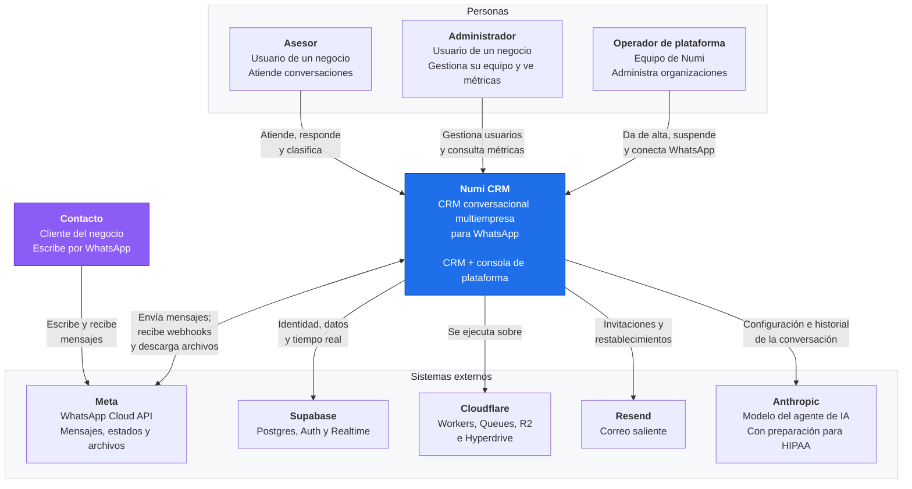

### 2.2 Quién usa el sistema

| Actor | Quién es | Qué hace | Por dónde entra |
| --- | --- | --- | --- |
| **Asesor** | Empleado de un negocio cliente | Atiende las conversaciones que tiene asignadas, responde, clasifica contactos | CRM, rutas de la raíz (ADR-009) |
| **Administrador** | Responsable del negocio cliente | Todo lo del asesor, más gestionar su equipo (`RF-USR-*`), ver métricas y configurar | CRM, mismas rutas más las de gestión |
| **Operador de plataforma** | Equipo de Numi | Da de alta organizaciones, invita al primer administrador, conecta WhatsApp, suspende y reactiva | Consola, rutas bajo `/plataforma` (ADR-002, ADR-009) |

**El contacto no es usuario del sistema.** Es la persona que escribe al negocio por WhatsApp, y aparece en el diagrama porque origina casi todo el tráfico — pero nunca toca Numi CRM: su interfaz es WhatsApp. Esta distinción importa porque explica por qué no hay ninguna pantalla pública ni ningún endpoint sin autenticar salvo el webhook.

**El operador no pertenece a ninguna organización**, y esa separación es estructural, no de permisos: vive en una tabla propia (ADR-007) y la consola se conecta a la base con un rol que **no tiene permiso sobre las tablas de mensajes** (ADR-006). Por eso `RF-TRV-07` —el contenido de las conversaciones nunca llega a la consola— no depende de que nadie escriba la consulta equivocada.

### 2.3 De qué depende el sistema

| Sistema externo | Para qué | Qué pasa si falla | Decisión |
| --- | --- | --- | --- |
| **Meta, WhatsApp Cloud API** | Recibir mensajes por webhook, enviar, descargar archivos, informar estados | No se envía ni se recibe; lo ya guardado se lee | ADR-001, ADR-005, ADR-012 |
| **Supabase Postgres** | Todos los datos del sistema | El webhook responde error y **Meta reintenta 7 días** | ADR-003, ADR-006 |
| **Supabase Auth** | Identidad: quién es cada quien | Las sesiones abiertas siguen; nadie nuevo entra | ADR-007 |
| **Supabase Realtime** | Avisar que hay algo nuevo | La bandeja actualiza cada 60 s; se pierde la inmediatez | ADR-008 |
| **Cloudflare Workers** | Ejecutar la API, el consumidor y servir el frontend | El sistema entero | ADR-003, ADR-009 |
| **Cloudflare Queues** | Desacoplar el webhook del procesamiento | El webhook sigue guardando; el procesamiento se atrasa | ADR-005 |
| **Cloudflare R2** | Guardar los adjuntos | Todo menos ver archivos | ADR-010 |
| **Resend** | Invitaciones y restablecimientos | **El alta de organizaciones**: sin correo no hay invitación | ADR-007, ADR-011 |
| **Anthropic** | El modelo que responde el agente de IA | El agente escala a un asesor tras dos fallos; el CRM funciona igual que sin agente | ADR-014 |

**Dos observaciones sobre esta tabla**, ambas desarrolladas en la sección 8:

1. **La concentración en Supabase es consciente.** Postgres, identidad y tiempo real vienen del mismo proveedor, que tiene antecedentes de caídas. Se asumió a cambio de operar una pieza en lugar de tres, con dos personas. La mitigación no es evitar la dependencia, sino que ninguna caída cause pérdida irreversible: ADR-011 lo documenta caso por caso.

2. **Anthropic es la única dependencia que recibe contenido de las conversaciones.** Hasta ADR-014, el contenido nunca salía del sistema: `RF-TRV-07` lo mantenía fuera de la consola, los registros y las métricas, y ADR-010 fuera de las URL públicas. El agente de IA rompe esa propiedad por primera vez, y con clínicas en el segmento inicial ese contenido incluye datos de salud. Por eso ADR-014 condiciona la conexión de cualquier cliente real a tener habilitada la **preparación para HIPAA**, que se activa por autoservicio en la consola con efecto inmediato — y que, por ser permanente, es una decisión a tomar conscientemente. La sección 7 desarrolla el recorrido de los datos sensibles.

3. **Resend parece el más modesto de la lista y es el más urgente.** Sin correo no hay invitación, y sin invitación el primer administrador de un negocio no entra (`RF-PLT-ORG-06`). Es ruta crítica del alta, y además su configuración —SPF, DKIM y DMARC— depende de propagación de DNS, que no la controla el equipo. ADR-011 recomienda resolverlo en la semana del 19 de octubre, antes de construir la consola.

### 2.4 Qué queda fuera del sistema

Declararlo evita que el diseño crezca por inercia (`CLAUDE.md` §4, regla 7):

| Fuera | Por qué |
| --- | --- |
| Otros canales: Instagram, Messenger, correo, SMS | El MVP es solo WhatsApp (`CLAUDE.md` §8). El canal queda detrás de una interfaz, pero no se construye un segundo |
| Aplicación móvil | Web de escritorio en el MVP (`CLAUDE.md` §8) |
| Integraciones del agente con sistemas del negocio: agendar, consultar inventario | ADR-014 incorpora el agente de IA al MVP, pero solo para responder, escalar y cerrar. Las integraciones quedan para después |
| Constructor visual de automatizaciones | Sigue fuera (`docs/01_definicion_mvp_v2.2.md` §6) |
| Facturación y cobro a los negocios | La consola administra, no cobra (ADR-002) |
| Autoservicio de alta | Las organizaciones las crea un operador (ADR-002) |
| Integraciones con sistemas del negocio | Ningún requisito las pide |

---

## 3. Contenedores (C4 nivel 2)

Esta sección abre el sistema. Un **contenedor** en C4 es algo que se ejecuta o que almacena datos por separado —no es un contenedor de Docker—. La pregunta que responde: qué piezas hay, cuáles se despliegan, cuáles son recursos gestionados y cómo se hablan entre sí.

### 3.1 Qué se despliega y qué no

Conviene empezar por aquí, porque mirando el diagrama es fácil contar piezas y creer que son servicios.

| Contenedor | ¿Se despliega? | ¿Hay que operarlo? |
| --- | --- | --- |
| Worker de la aplicación | **Sí** | Un `deploy` |
| Worker de la API | **Sí** | Un `deploy` |
| Consumidor de eventos | No — función del Worker de la API | No |
| Consumidor de archivos | No — función del Worker de la API | No |
| Consumidor del agente | No — función del Worker de la API | No |
| Cola de eventos, de archivos, del agente | No — recursos gestionados | No |
| Postgres, Auth, Realtime | No — servicio gestionado | No |
| R2, Hyperdrive | No — recursos gestionados | No |

**Dos despliegues. Cero servidores que mantener vivos.**

Los tres consumidores son funciones exportadas del mismo Worker de la API, no procesos aparte:

```typescript
export default {
  fetch(request, env) { /* API y webhook */ },
  queue(batch, env)   { /* enruta por batch.queue */ },
}
```

**Por qué dos Workers y no uno.** Lo fijó ADR-009, punto 2: *"uno sirve la aplicación, otro es la API. Se despliegan por separado y fallan por separado."* Esa separación compra dos cosas concretas: desplegar un cambio de interfaz no arriesga el webhook —que es la pieza con el requisito duro de `RF-TRV-02`—, y un error en la aplicación no puede tumbar la recepción de mensajes.

**Por qué los consumidores no son Workers aparte.** Comparten el código de negocio con la API —guardar un mensaje, resolver una conversación, publicar un aviso— y separarlos obligaría a duplicarlo o a empaquetarlo. Con dos personas y siete semanas, eso es costo sin beneficio (`CLAUDE.md` §4, regla 9). Si un consumidor necesitara escalar o fallar de forma independiente, Workers permite separarlo después sin rediseño.

### 3.2 Diagrama de contenedores

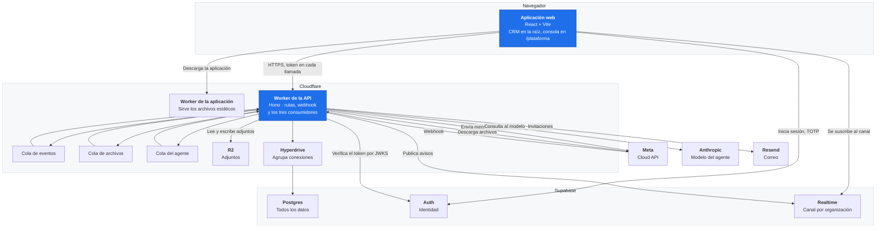

Las flechas que salen de las colas y vuelven al Worker de la API representan la entrega a los consumidores, que viven dentro de ese mismo Worker.

### 3.3 Cada contenedor

| Contenedor | Responsabilidad | Qué **no** hace | Decisión |
| --- | --- | --- | --- |
| **Aplicación web** | Renderizar las 31 vistas, manejar sesión, suscribirse al canal | No accede a la base, ni directo ni por el cliente de Supabase. No decide permisos: los refleja | ADR-009 |
| **Worker de la aplicación** | Servir los archivos estáticos | No tiene acceso a datos ni a secretos | ADR-009 |
| **Worker de la API** | Rutas del CRM y la consola, webhook, envío, y los tres consumidores | No guarda estado en memoria entre peticiones | ADR-003 |
| **Cola de eventos** | Desacoplar el webhook del procesamiento | No garantiza orden — el orden vive en la base | ADR-005 |
| **Cola de archivos** | Descargas de adjuntos, con su propio ritmo | No bloquea el procesamiento de mensajes | ADR-005 |
| **Cola del agente** | Disparar al agente sin acoplarlo al camino de entrada | No participa en `RF-TRV-02` | ADR-014 |
| **Postgres** | Todos los datos, el aislamiento por RLS, la unicidad | — | ADR-006 |
| **Hyperdrive** | Agrupar conexiones desde Workers | — | ADR-003 |
| **Auth** | Responder "quién eres" | **No autoriza.** Eso lo hace la API en cada petición | ADR-007 |
| **Realtime** | Transportar avisos sin contenido | **No transporta datos.** El aviso no es el dato | ADR-008 |
| **R2** | Guardar adjuntos | No se expone al navegador. Todo acceso pasa por la API | ADR-010 |

### 3.4 Las tres colas, y por qué son tres

Es la pregunta natural al ver el diagrama. **No son tres servicios: son tres configuraciones de un recurso gestionado.** Están separadas porque tienen tolerancias incompatibles:

| Cola | Reintentos | Si se atasca |
| --- | --- | --- |
| **Eventos** | Hasta 100 | Los mensajes no llegan a la bandeja. **Grave** — toca `RF-TRV-02` |
| **Archivos** | Dentro de 7 días | Se ven los mensajes, no los adjuntos |
| **Agente** | **Dos**, luego escala a una persona | El agente no responde; las personas sí |

Con una sola cola, un documento de 100 MB reintentándose bloquearía mensajes de texto, y una caída del modelo atrasaría los mensajes entrantes. **Separarlas no agrega operación: agrega aislamiento de fallos.** Es lo que mantiene el requisito más duro del sistema a salvo de las piezas más lentas.

Las tres encolan **referencias, no contenido** —límite de 128 KB por mensaje (ADR-005)—, y las tres tienen cola de mensajes fallidos obligatoria: un evento que agota reintentos queda visible para el operador, nunca desaparece en silencio.

### 3.5 Los tres escritores

El sistema tiene **tres piezas que escriben datos y notifican**, y conviene tenerlas identificadas porque es donde se concentran los errores de concurrencia:

| Escritor | Qué escribe | Qué dispara el aviso |
| --- | --- | --- |
| **Consumidor de eventos** | Mensajes entrantes, conversaciones, cambios de estado desde Meta | Mensaje nuevo, cambio de estado |
| **API, camino de salida** | Mensajes del asesor, asignación derivada del envío | Mensaje saliente, cambio de asignación |
| **Consumidor del agente** | Respuestas del agente, escaladas | Mensaje del agente, escalada |

Los tres publican con **la misma función** (ADR-008, regla 4). Es lo que impide que el formato del aviso diverja y que el frontend tenga que entenderlo de tres maneras.

### 3.6 Cómo se protege el aislamiento en esta capa

`RF-TRV-01` no se cumple en un solo lugar: se cumple porque **cada contenedor que toca datos lo hace con un rol que no puede ver lo que no debe** (ADR-006).

| Quién | Rol de base | Alcance |
| --- | --- | --- |
| API, peticiones de un negocio | `app_user` | Solo la organización del contexto de la transacción |
| API, rutas de `/plataforma` | `app_platform` | Todas las organizaciones, **sin permiso sobre las tablas de mensajes** |
| Los tres consumidores | `app_worker` | Escribe en cualquier organización; lectura mínima |

La fila del medio es la que hace que `RF-TRV-07` sea estructural: una consulta de la consola contra la tabla de mensajes **falla**, no devuelve datos filtrados. No depende de que nadie escriba la consulta equivocada.

Ninguno de los tres roles tiene `bypassrls`.

### 3.7 Qué pasa si falla cada contenedor

Resumen; la sección 8 lo desarrolla con los caminos de recuperación.

| Si falla | Sigue funcionando | Se pierde |
| --- | --- | --- |
| Worker de la aplicación | El webhook y la API | El acceso a la interfaz |
| Worker de la API | Nada | Todo, pero **Meta reintenta 7 días** |
| Cola de eventos | El webhook sigue guardando eventos crudos | El procesamiento se atrasa; se reprocesa desde la tabla |
| Cola del agente | Todo lo demás | El agente no responde |
| Postgres | Nada | El webhook responde error y Meta reintenta |
| Realtime | Todo; la bandeja actualiza cada 60 s | La inmediatez |
| R2 | Todo menos ver archivos | Acceso a adjuntos |
| Anthropic | El CRM completo | El agente escala a personas tras dos fallos |
| Resend | Todo | **El alta de organizaciones** |

Dos observaciones que salen de esta tabla. **Solo una caída larga de Postgres causa pérdida irreversible**, por la caducidad de los identificadores de archivo de Meta a los 7 días — y es lo que justifica que la alerta de webhook caído sea la primera de ADR-011. Y **el fallo más disruptivo para el negocio no es el más técnico**: sin Resend no entran clientes nuevos, aunque todo lo demás funcione.

---

## 4. Componentes del backend (C4 nivel 3)

Esta sección abre el Worker de la API. Son **módulos de un mismo despliegue**, no microservicios: ADR-003 fijó *"backend modular, no microservicios"*. La separación es de código y de responsabilidad, no de proceso.

### 4.1 La regla que ordena todo: cada dato tiene un dueño

Un módulo es **dueño** de unas tablas: es el único que las escribe. Los demás leen a través de él, no por su cuenta.

Esto no es formalismo. Con dos personas trabajando en paralelo sobre 63 requisitos, es lo que evita que la lógica de la ventana de 24 horas quede escrita en tres lugares distintos y que uno de ellos se olvide al cambiarla. **Si una regla de negocio vive en un solo módulo, se corrige una vez.**

La excepción deliberada está en §4.4.

### 4.2 Diagrama de componentes

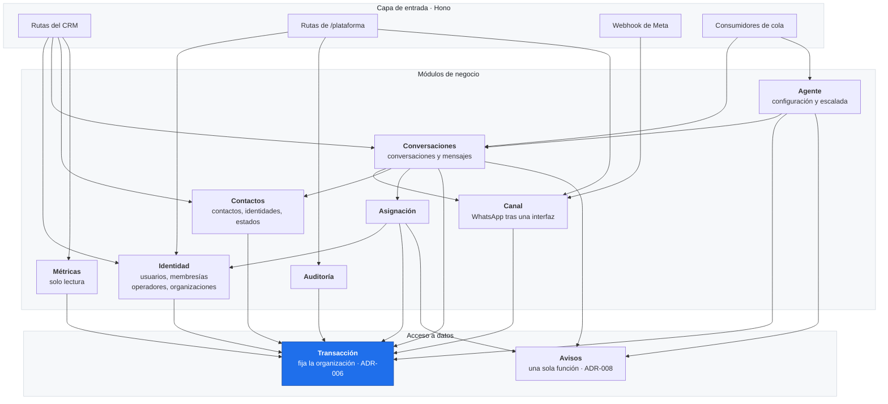

### 4.3 Qué es dueño cada módulo

| Módulo | Dueño de | Requisitos | Decisión |
| --- | --- | --- | --- |
| **Identidad** | Organizaciones, usuarios, membresías, invitaciones, operadores | `RF-AUT-01` a `07`, `RF-USR-01` a `08`, `RF-PLT-ACC-*`, `RF-PLT-ORG-*` | ADR-007 |
| **Canal** | Credenciales de WhatsApp por organización, eventos crudos recibidos | `RF-PLT-WA-01` a `08`, `RF-TRV-02` | ADR-001, ADR-005 |
| **Conversaciones** | Conversaciones, mensajes, adjuntos | `RF-CNV-01` a `16`, `RF-CNV-10a` a `10e` | ADR-005, ADR-012, ADR-004 |
| **Contactos** | Contactos, identidades por canal, historial de estados | `RF-CON-01` a `09`, `RF-EST-01` a `04` | — |
| **Asignación** | Nada propio: escribe el responsable de la conversación | `RF-CNV-11`, `RF-CNV-12`, `RF-CFG-03`, `RF-USR-06` | — |
| **Agente** | Configuración del agente, intenciones de respuesta | `RF-MET-09`, y lo que fija ADR-014 | ADR-014 |
| **Métricas** | **Nada.** Solo lee, por vistas SQL | `RF-MET-01` a `08`, `RF-EST-01` | ADR-013 |
| **Auditoría** | Registro de acciones de operador | `RF-PLT-AUD-01`, `02`, `05`, `RF-PLT-SEG-01` | ADR-002 |

Dos filas merecen comentario.

**Asignación no es dueña de ninguna tabla**, y aun así es un módulo. La razón: la regla de `RF-CNV-12` —*"se asigna al asesor activo y disponible con menos conversaciones abiertas"*— necesita contar conversaciones abiertas por asesor y cruzarlo con disponibilidad (`RF-USR-06`) y con la configuración del negocio (`RF-CFG-03`). Esa lógica se dispara desde tres lugares distintos: un mensaje entrante, un envío del asesor que autoasigna (`RF-CNV-11`, ADR-012) y una escalada del agente (ADR-014). **Tres disparadores, una sola regla**: si viviera en cada camino, serían tres implementaciones que se desincronizan.

**Métricas no escribe nada.** ADR-013 decidió consultas SQL directas sobre vistas con `security_invoker`. No hay tablas de resumen que puedan desincronizarse, y por eso no hay nada que mantener. Es el módulo más barato del sistema.

### 4.4 La excepción: por qué el consumidor no pasa por "Conversaciones"

Hay una dependencia en el diagrama que rompe la regla del dueño, y conviene explicarla antes de que parezca un error.

El consumidor de eventos **escribe mensajes y conversaciones**, que son propiedad del módulo de Conversaciones — pero lo hace con el rol `app_worker` y con la organización del evento, no con la de una sesión de usuario (ADR-006). El módulo de Conversaciones, cuando lo invoca una ruta del CRM, usa `app_user` y la organización del token.

**Es el mismo código de negocio con dos contextos de ejecución distintos.** La forma de que esto no se convierta en dos implementaciones: el módulo expone sus operaciones recibiendo el contexto como parámetro, y nunca lo deduce por su cuenta. Es la misma regla que ADR-003 fijó para el framework —*"el código de negocio no importa nada de Hono y recibe sus dependencias como parámetros"*— aplicada al contexto de base de datos.

**Señal de que el diseño se desvió:** si aparece una función `guardarMensajeDesdeWebhook` distinta de `guardarMensaje`, hay dos caminos donde debería haber uno.

### 4.5 El módulo de canal: la frontera con Meta

`CLAUDE.md` §9 pide *"WhatsApp detrás de una interfaz de canal"*. Concretamente, el módulo expone cuatro operaciones y **nada más**:

| Operación | Quién la llama |
| --- | --- |
| Validar la firma de un evento entrante | Webhook (ADR-005) |
| Normalizar un evento a mensaje | Consumidor de eventos |
| Enviar un mensaje | Conversaciones, en el camino de salida (ADR-012) |
| Obtener una URL de descarga de archivo | Consumidor de archivos (ADR-004) |

**Ningún otro módulo sabe que existe Meta.** Conversaciones pide "enviar"; no sabe de `wamid`, ni de la ventana de 24 horas como concepto de Meta, ni del código 131047.

Tres reglas que esta frontera impone, todas de ADR-001:

1. **Toda llamada recibe la organización.** No existe un cliente de WhatsApp que asuma un token global.
2. **El token se descifra en memoria, en el momento de la llamada** (ADR-011), y nunca sale de este módulo.
3. **Un número no puede estar en dos organizaciones** (`RF-PLT-WA-07`), por unicidad en la base.

La prueba de que la frontera está bien puesta: **agregar Instagram debería tocar este módulo y ninguno más.** Hoy no está en alcance, pero es el criterio para saber si la interfaz es real o decorativa.

### 4.6 Dos piezas compartidas que no son módulos de negocio

Son infraestructura, y las usa todo el mundo. Aparecen en el diagrama porque concentran dos requisitos que no se negocian.

**La función de transacción** (ADR-006). Recibe la organización y la operación a ejecutar; abre la transacción, fija el contexto con alcance local, ejecuta y cierra. **Ninguna consulta del sistema abre transacciones por su cuenta.**

Es lo que convierte "fijar el contexto en cada transacción" en una propiedad estructural en lugar de una disciplina. Si cada módulo lo hiciera por su cuenta, `RF-TRV-01` dependería de que nadie se olvide nunca — y `RF-TRV-01` es la condición de éxito del piloto.

**La función de avisos** (ADR-008, regla 4). Recibe la organización, el tipo de evento y el identificador de la conversación, y publica en el canal privado. La llaman los tres escritores de §3.5. Garantiza que el aviso tenga el mismo formato venga de donde venga, y que **nunca lleve contenido** (`RF-TRV-07`).

### 4.7 Dónde vive cada requisito que no se negocia

`CLAUDE.md` §8 lista nueve requisitos innegociables. Esta tabla dice qué módulo responde por cada uno — es el insumo de la sección 12.

| Requisito | Dónde se cumple | Cómo |
| --- | --- | --- |
| Aislamiento entre negocios (`RF-TRV-01`) | Función de transacción + los tres roles | Estructural: RLS más filtro explícito |
| Webhook confiable (`RF-TRV-02`) | Canal + consumidor de eventos | Firma validada; unicidad `(organization_id, wamid)` |
| Orden de mensajes (`RF-CNV-06`) | Conversaciones | Orden por marca de tiempo de Meta, con desempate estable |
| Ventana de 24 h (`RF-CNV-08`) | Canal, verificada antes de enviar | Rechazo local más el código de Meta como verdad |
| Estados del mensaje (`RF-CNV-09`) | Conversaciones | Progresión que no retrocede; `error` como excepción |
| Datos sensibles fuera de consola y métricas (`RF-TRV-07`) | Permisos de `app_platform` | Imposible por permisos, no por disciplina |
| Tokens cifrados (`RF-PLT-SEG-02`) | Canal | Descifrado en memoria; nunca al navegador ni a registros |
| Rol verificado en cada petición (`RF-PLT-SEG-01`) | Identidad | Consulta en base; el rol no viaja en el token |
| Organización suspendida (`RF-AUT-07`, `RF-CNV-16`) | Identidad al entrar; Conversaciones al enviar | Se verifica al enviar, nunca al recibir |

La última fila contiene la asimetría más importante del sistema: **la suspensión bloquea la salida, no la entrada.** Un negocio suspendido sigue recibiendo y guardando mensajes; simplemente nadie puede entrar ni responder.

### 4.8 Reglas de dependencia

Para que la modularidad sobreviva a siete semanas de prisa:

1. **La capa de entrada no tiene lógica de negocio.** Rutas, validación y serialización. Si una ruta decide algo, ese algo pertenece a un módulo.
2. **Ningún módulo importa nada de Hono** (ADR-003).
3. **Los módulos no se llaman en círculo.** Conversaciones llama a Canal, Contactos y Asignación; ninguno de los tres llama de vuelta a Conversaciones. El agente es la única pieza que llama hacia Conversaciones, y lo hace desde fuera, por la cola.
4. **Métricas no llama a nadie.** Solo lee vistas.
5. **Auditoría se llama, nunca llama.** Registra lo que le pasan.

---

## 5. Componentes del frontend (C4 nivel 3)

Esta sección abre la aplicación web: cómo se organizan **31 vistas** —18 del CRM y 13 de la consola— en una sola aplicación, y cómo se resuelven sesión, datos, estado y tiempo real.

ADR-009 fijó lo esencial: aplicación de página única con React y Vite, servida desde Workers, **una sola aplicación con dos áreas**. Y una propiedad que gobierna todo lo demás: *"el frontend no tiene acceso a la base de datos. Ni directo, ni por el cliente de Supabase, ni por el canal de tiempo real."*

### 5.1 La regla que ordena la sección

**La interfaz no decide permisos; los refleja.**

Oculta lo que el usuario no puede hacer, pero la autoridad está en el backend, que verifica en cada petición (ADR-007). Un asesor que fuerce la ruta `/plataforma` verá el marco de la consola y recibirá errores de autorización en cada llamada.

De ahí se sigue algo que conviene decir sin rodeos, porque es un error frecuente: **que el código de la consola llegue al navegador no otorga ningún permiso.** La carga diferida del área de plataforma es rendimiento, no seguridad.

### 5.2 Estructura

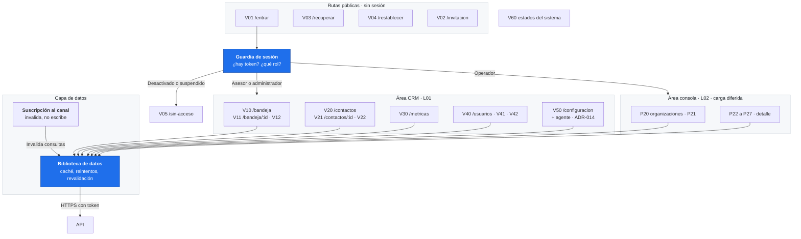

### 5.3 Las dos áreas

| | CRM | Consola |
| --- | --- | --- |
| Rutas | Raíz: `/bandeja`, `/contactos`, `/metricas`, `/usuarios`, `/configuracion` | `/plataforma/*` |
| Estructura | L01 | L02, con marco visual propio y permanente |
| Quién entra | Asesor, administrador | Operador de plataforma |
| Vistas | 18 | 13 |
| Carga | Con la aplicación | **Diferida** |

**Marco visual distinto y permanente** para la consola (`RF-PLT-ACC-05`): barra lateral con tratamiento propio y la etiqueta "Consola de plataforma · Numi", para que un operador nunca confunda en qué está trabajando.

**La carga diferida importa por rendimiento.** El paquete inicial es el punto débil de una aplicación de página única, y 31 vistas en un solo paquete sería un problema. Un asesor nunca descarga el código de la consola. También se difieren las vistas pesadas del CRM, como métricas.

### 5.4 Sesión

El cliente de Supabase Auth en el navegador **se usa solo para autenticar** —entrar, salir, refrescar el token, el TOTP del operador—. **Nunca para consultar datos** (ADR-009).

| Situación | Qué hace la interfaz | Requisito |
| --- | --- | --- |
| Sesión expirada | Guarda la ruta actual, lleva a V01, devuelve al usuario donde estaba tras entrar | `RF-AUT-06` |
| Usuario desactivado | V05 con el mensaje correspondiente | `RF-AUT-05` |
| Organización suspendida | V05 con el mensaje correspondiente | `RF-AUT-07` |

**Lo que no es obvio y hay que construir bien:** las tres situaciones pueden ocurrir **a mitad de sesión**, no solo al entrar. ADR-007 verifica el estado del usuario y de la organización en **cada petición**, así que una suspensión tiene efecto inmediato aunque el token siga siendo válido.

Consecuencia: **el manejo de esas respuestas vive en el cliente de la API, no en cada vista.** Si cada vista lo manejara por su cuenta, habría 31 lugares donde olvidarlo, y el olvido se vería como una pantalla congelada sin explicación.

### 5.5 Datos y estado

ADR-009 fijó una biblioteca de datos de servidor —TanStack Query como ejemplo— y la separación entre estado de servidor y estado de interfaz.

| Tipo de estado | Qué es | Dónde vive |
| --- | --- | --- |
| **De servidor** | Conversaciones, mensajes, contactos, usuarios, métricas | La biblioteca de datos: caché, reintentos, revalidación |
| **De interfaz** | Filtros activos, paneles abiertos, borradores | Local al componente |

**No hace falta un gestor de estado global.** Con la biblioteca encargándose del estado de servidor —que es casi todo el estado de este producto— un gestor global no tendría trabajo (`CLAUDE.md` §4, regla 9).

Dos decisiones de datos que vienen de requisitos concretos:

- **La búsqueda de contactos es del servidor** (`RF-TRV-03`: menos de 1 segundo con 5.000 contactos). No se descargan 5.000 contactos para filtrar en el navegador.
- **La lista de conversaciones se pagina** (`RF-CNV-09` para contactos, y el mismo criterio para la bandeja). Una bandeja de 6.000 conversaciones no se carga entera.

### 5.6 Tiempo real: el aviso invalida, la API entrega

Este es el punto donde el frontend y ADR-008 se encuentran, y tiene una propiedad que conviene no perder.

1. El navegador se suscribe al canal privado de su organización.
2. Al recibir un aviso, **invalida las consultas afectadas**.
3. La biblioteca de datos recarga desde la API, que verifica permisos.
4. **Nunca se escriben datos en la caché desde el aviso.**

El punto 4 es el que sostiene todo: el aviso no trae contenido (ADR-008), y escribir desde él abriría un camino de datos que no pasa por la API.

**La propiedad que vale la pena notar:** el tiempo real y la red de seguridad usan **el mismo camino** —invalidar y recargar—. No hay dos rutas por las que los datos lleguen a la pantalla, así que no pueden contradecirse.

La red de seguridad, de ADR-008: revalidar cada 60 segundos, al recuperar el foco de la ventana y al reconectar el canal.

**El contador de conversaciones sin responder** (`RF-CNV-15`) **se recalcula**, nunca se incrementa a ciegas. Un contador que solo suma se desincroniza en cuanto se pierde un aviso.

### 5.7 Componentes compartidos

El CRM y la consola comparten tablas, formularios, estados y ventanas. Lo que cambia es el marco visual del área — una sola aplicación hace esto natural.

Tres requisitos transversales que **se resuelven una vez, en componentes compartidos**, y nunca vista por vista:

| Requisito | Cómo |
| --- | --- |
| `RF-TRV-04` | Estados de carga, vacío y error como componentes del design system. Ninguna vista los implementa por su cuenta |
| `RF-TRV-05` | Formateo centralizado: fechas en zona de Bogotá, textos en español de Colombia. **Nunca formateo suelto en las vistas** |
| `RF-TRV-06` | Componentes accesibles desde la base —foco visible, teclado, contraste—, porque agregarlo después cuesta mucho más |

El de `RF-TRV-05` tiene una trampa conocida: ADR-013 ya advirtió que los límites de período se calculan en hora de Bogotá, no en UTC, y que ese detalle produce números mal por un día entero en los bordes. **El mismo criterio aplica a toda fecha que se muestre.**

### 5.8 Lo que el agente agrega al frontend

ADR-014 tiene dos consecuencias en la interfaz, pequeñas pero visibles:

1. **Configuración del agente**, dentro de V50: interruptor, información del negocio, nombre y tono, reglas de escalada y preguntas y respuestas fijas.
2. **El autor del mensaje se distingue en la conversación.** El asesor debe ver qué dijo el agente y qué dijo una persona. Es un cambio en V11, no una vista nueva.

El indicador `RF-MET-09` —porcentaje de conversaciones resueltas sin escalar— entra en V30 como un indicador más.

### 5.9 Lo que no hace el frontend

Declararlo evita errores de diseño que serían difíciles de revertir:

| No hace | Por qué |
| --- | --- |
| Consultar la base, ni por el cliente de Supabase | ADR-009. La API es el único camino a los datos |
| Guardar secretos | Solo lleva la URL de la API y la clave pública de Auth. La clave de publicación de Broadcast y los tokens de WhatsApp viven en el servidor |
| Decidir permisos | Los refleja. La autoridad es del backend (`RF-PLT-SEG-01`) |
| Renderizar en servidor | Todas las vistas están detrás de sesión; no hay nada indexable |
| Escribir en la caché desde un aviso | Abriría un camino de datos fuera de la API |

### 5.10 Punto abierto que sigue abierto

ADR-009 dejó registrado que **la elección de React no está justificada en el ADR**: depende de qué conoce Anthony, que tiene asignada la interfaz. Todo lo de esta sección —aplicación de página única, dos áreas, sesión, datos, tiempo real, componentes compartidos— **se mantiene igual con Vue o Svelte**.

Sigue pendiente y debe resolverse antes de empezar la interfaz.

---

## 6. Flujos críticos

Los cinco flujos que `CLAUDE.md` §8 exige con diagrama de secuencia. Es la sección que más sirve para detectar huecos, porque obliga a recorrer cada camino de punta a punta en vez de confiar en que las piezas encajan.

Para cada uno: el diagrama, qué puede fallar y qué requisito se juega.

### 6.1 Mensaje entrante, de Meta a la bandeja

El camino más importante del sistema. Es donde viven las tres invariantes.

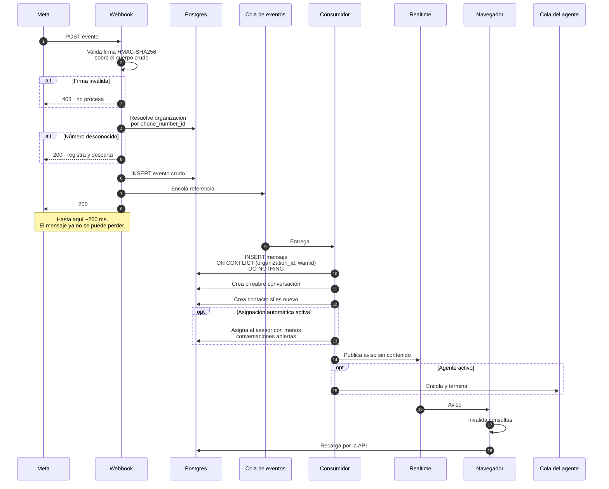

**Qué se juega aquí**

| Invariante | Cómo se cumple | Paso |
| --- | --- | --- |
| **No perder** (`RF-TRV-02`) | El evento se guarda crudo **antes** del 200. Si falla el guardado, no hay 200 y Meta reintenta 7 días | 5-7 |
| **No duplicar** (`RF-TRV-02`) | Unicidad `(organization_id, wamid)`. Funciona sin importar cuántas veces reintente Meta o entregue la cola | 9 |
| **Orden** (`RF-CNV-06`) | Por marca de tiempo de Meta, con desempate estable. Ni Meta ni la cola garantizan orden | — |
| **Aislamiento** (`RF-TRV-01`) | El consumidor usa `app_worker` con la organización del evento | 9-12 |

**La decisión que define este flujo** es el corte en el paso 7: el webhook responde 200 habiendo guardado solo el evento crudo. Lo único que Meta castiga es no recibir un 200; todo lo demás es recuperable desde esa tabla.

**El detalle que más falla en la práctica:** la firma se calcula sobre el **cuerpo crudo**, con unicode escapado y hexadecimal en minúsculas. ADR-005 lo advierte: hay que probarlo con un mensaje con tildes o emoji antes de darlo por bueno. Es un error silencioso.

**Si el número no corresponde a ninguna organización, se responde 200**, no error. Reintentar algo que nunca va a resolverse solo acumula ruido.

### 6.2 Envío de un mensaje, con ventana de 24 horas

Va en dirección contraria al flujo anterior: síncrono, porque aquí espera una persona.

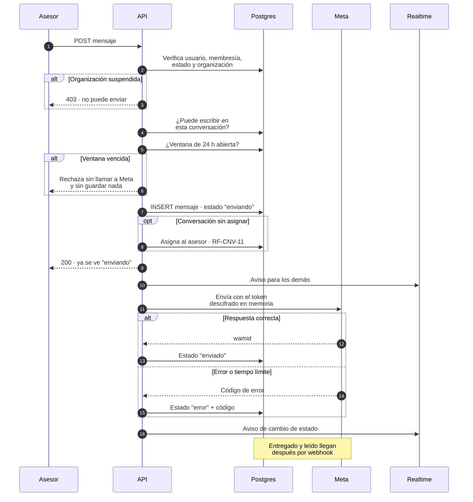

**Por qué síncrono, si todo lo demás es por cola.** ADR-012 lo justificó: la diferencia es **quién espera**. En el webhook espera Meta, que castiga la demora y reintenta sola. Aquí espera una persona mirando la pantalla, que necesita saber si su mensaje salió.

**El caso difícil es el tiempo límite** (paso 16). Si la llamada a Meta expira, el sistema **no sabe** si el mensaje salió. Reintentar puede duplicarlo; no reintentar puede perderlo. La decisión la toma el asesor, informado: el mensaje queda en error con un texto que dice que puede haberse enviado. Es la opción honesta.

**La verificación local no reemplaza la respuesta de Meta.** El paso 5 evita el viaje innecesario y da el mensaje claro; si Meta devuelve 131047 igual, se aplica el mismo tratamiento. **La respuesta de Meta es la verdad.**

### 6.3 Asignación automática de una conversación nueva

El flujo más corto, y el que más lugares toca.

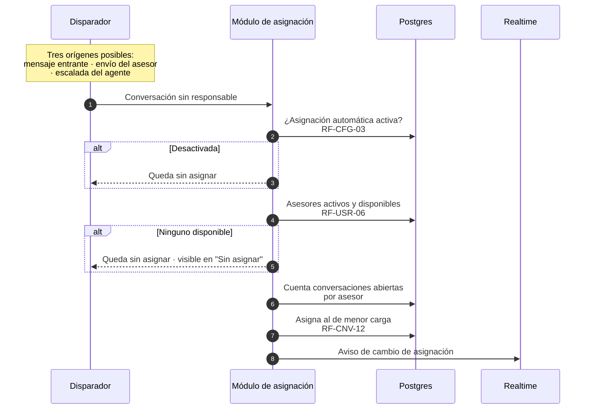

**Por qué es un módulo y no código suelto.** La misma regla se dispara desde tres lugares: un mensaje entrante (6.1), un asesor que responde una conversación sin asignar (`RF-CNV-11`, 6.2) y una escalada del agente (6.5). **Tres disparadores, una sola regla.** Si viviera en cada camino, serían tres implementaciones que se desincronizan.

**El caso que hay que manejar bien:** que no haya nadie disponible no es un error. La conversación queda sin asignar y visible en el filtro correspondiente (`RF-CNV-04`). Un sistema que fallara aquí dejaría mensajes sin atender por un problema de personal.

### 6.4 Alta de una organización desde la consola

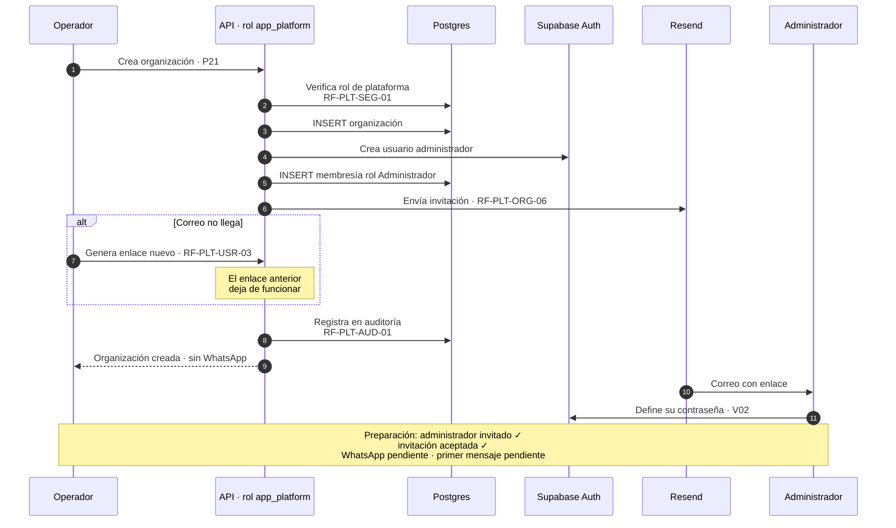

**La dependencia frágil de este flujo es Resend.** Sin correo no hay invitación, y sin invitación el primer administrador no entra. Es ruta crítica del alta, no un detalle de configuración (ADR-007, ADR-011).

**La mitigación ya estaba en los requisitos por otra razón:** `RF-PLT-USR-03` permite generar un enlace nuevo que el operador envía por otro medio. Un fallo de Resend tiene salida manual.

**Una organización recién creada no tiene WhatsApp conectado**, y eso es normal (ADR-001). La lista de preparación lo muestra como pendiente.

**Todo paso queda en auditoría desde el primer día** (ADR-002), aunque la vista P25 llegue después. Un registro con huecos no se reconstruye.

### 6.5 Suspensión y reactivación de una organización

El flujo con la asimetría más importante del sistema.

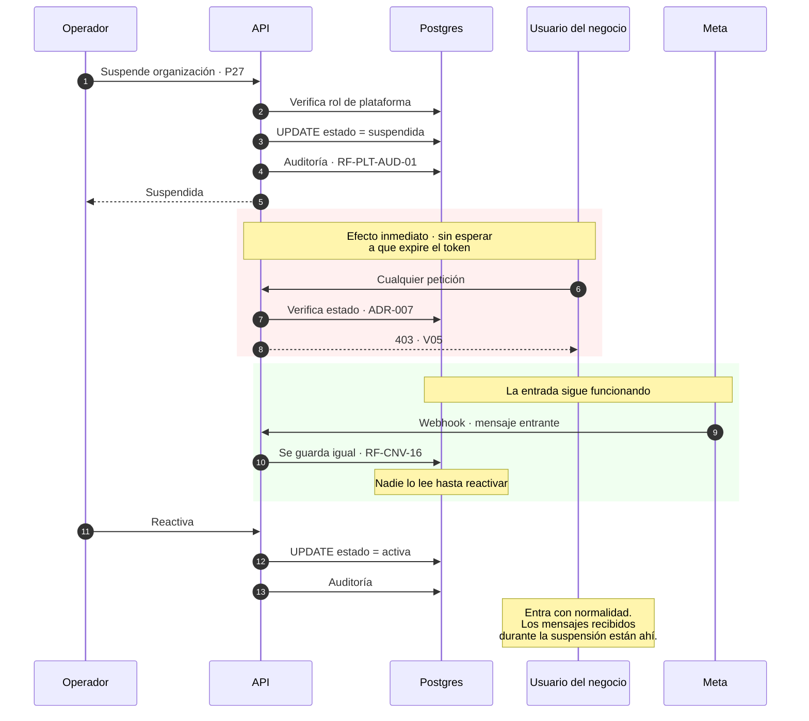

**La asimetría:** la suspensión **bloquea la salida, no la entrada**. Nadie entra ni envía, pero los mensajes entrantes se siguen guardando (`RF-AUT-07`, `RF-CNV-16`).

Es deliberado y es lo correcto: un negocio suspendido por falta de pago no debería perder los mensajes de sus clientes. Al reactivar, encuentra todo.

**El efecto es inmediato** porque ADR-007 consulta el estado en cada petición en vez de confiar en el token. Un token válido de una hora no mantiene dentro a nadie.

**La suspensión se verifica al enviar, nunca al recibir.** Es una propiedad del camino de salida.

### 6.6 Qué revelaron estos cinco flujos

Recorrerlos de punta a punta confirma tres cosas y deja una pendiente.

**Confirmado:**

1. **Los tres escritores de §3.5 aparecen en los flujos** y los tres publican avisos con la misma función. No hay un cuarto camino oculto.
2. **La asignación se dispara desde tres flujos distintos** (6.1, 6.2, 6.5 vía agente) y en los tres pasa por el mismo módulo.
3. **Ningún flujo lleva contenido de conversaciones a la consola, los registros o el tiempo real** (`RF-TRV-07`).

**Pendiente de resolver al diseñar el detalle:** el flujo 6.1 crea contacto, conversación y mensaje, y puede asignar — **todo eso debe ocurrir en una sola transacción**. Si se guardara el mensaje y fallara la asignación, quedaría una conversación en un estado que ningún flujo contempla. La sección 4 ya fija que la función de transacción es el único lugar que las abre; aquí queda explícito **que este flujo necesita una sola**.

---

## 7. Multiempresa y seguridad

Esta sección responde cuatro preguntas: cómo se aísla cada negocio en cada capa, por dónde viaja un dato sensible, dónde viven los secretos y qué ve exactamente el rol de plataforma.

**El criterio que la ordena:** `RF-TRV-01` es la condición de éxito del piloto (`docs/01_definicion_mvp_v2.2.md` §11). Un requisito de ese peso **no puede depender de que dos personas con prisa no olviden nunca una cláusula**. Por eso, donde se puede, el aislamiento es estructural —imposible por permisos— en lugar de disciplinado.

### 7.1 Las cinco capas de aislamiento

Un dato de la organización A tendría que atravesar cinco controles para llegar a un usuario de B. No es redundancia decorativa: cada capa cubre el modo de fallo de la anterior.

| # | Capa | Qué impide | Si esta capa falla sola |
| --- | --- | --- | --- |
| 1 | **Token verificado y membresía consultada en la base** | Que alguien actúe como miembro de una organización a la que no pertenece | La capa 2 no recibe organización válida |
| 2 | **Filtro explícito por `organization_id`** | El cruce accidental en una consulta | **RLS lo detiene** (capa 3) |
| 3 | **RLS en toda tabla con datos de negocio** | El cruce cuando alguien olvidó el filtro | El filtro explícito ya lo impidió |
| 4 | **Permisos de rol de base** | Que la consola lea mensajes | — es la única capa para `RF-TRV-07` |
| 5 | **Políticas de canal de tiempo real** | Que un usuario se suscriba al canal de otra organización | — es la única capa para el canal |

**Las capas 2 y 3 se cubren mutuamente; las capas 4 y 5 no tienen respaldo.** Eso las vuelve las más delicadas, y es la razón de que ADR-006 y ADR-008 insistan en verificarlas por separado.

**El `organization_id` nunca viene del frontend.** Lo fijó `docs/01_definicion_mvp_v2.2.md` §8.3: *"el backend obtiene la organización autorizada desde la sesión y la membresía del usuario. No confía en el `organization_id` que envía el frontend"*.

### 7.2 Cómo se fija el contexto, y por qué en cada transacción

Hyperdrive opera en **modo transacción** y hace `RESET` al devolver la conexión al grupo: los `SET` no sobreviven a la transacción. Por eso el contexto se fija **en cada transacción, con alcance local**.

```
BEGIN
  SET LOCAL app.current_organization = '<id>'
  … las consultas …
COMMIT
```

Tres reglas que lo sostienen:

1. **Alcance local siempre.** Aunque Hyperdrive haga `RESET`, apoyar el requisito más importante del sistema en un detalle de implementación del proveedor sería imprudente.
2. **Transacciones cortas.** Una operación lógica, no un conjunto — Hyperdrive lo desaconseja explícitamente.
3. **Un solo lugar en el código abre transacciones** (§4.6). Ninguna consulta lo hace por su cuenta.

La tercera es la que convierte "fijar el contexto en cada transacción" de disciplina en estructura.

### 7.3 Los tres roles de base de datos

| Rol | Quién lo usa | Puede | No puede |
| --- | --- | --- | --- |
| `app_user` | API, peticiones de un negocio | Leer y escribir su organización | Ver otra organización |
| `app_platform` | API, rutas de `/plataforma` | Administrar todas las organizaciones | **Leer las tablas de mensajes** |
| `app_worker` | Los tres consumidores | Escribir en cualquier organización | Leer más de lo necesario |

**Ninguno tiene `bypassrls`.** Si alguno lo tuviera, su capa de RLS sería inexistente y nadie lo notaría — por eso es una de las siete pruebas automáticas.

**La fila del medio es la decisión más importante de la sección.** `app_platform` no obtiene su poder saltando RLS, sino **careciendo de permiso** sobre las tablas de mensajes. La diferencia es categórica:

> Una consulta de la consola contra la tabla de mensajes **falla con un error de permisos**. No devuelve datos filtrados, no devuelve un conjunto vacío: falla.

Eso convierte `RF-TRV-07` de una promesa en una imposibilidad. No depende de que nadie escriba la consulta equivocada.

**`app_worker` existe porque el consumidor no tiene usuario** y debe escribir aunque la organización esté suspendida (`RF-CNV-16`). Su política es por organización del evento, no por sesión.

### 7.4 Qué ve el rol de plataforma

`RF-PLT-USO-04` aplica a todas las vistas de la consola, sin excepción.

| Ve | No ve |
| --- | --- |
| Nombre, sector, ciudad, estado de la organización | El texto de cualquier mensaje |
| Cantidad de usuarios, fecha del último mensaje | El nombre o teléfono de un contacto |
| Salud del webhook: último evento, conteos, errores | El contenido de un adjunto |
| Auditoría de acciones de operadores | Las métricas del negocio |
| Que un token está guardado y cuándo se actualizó | El valor del token, ni un fragmento |

**Los indicadores de uso son cantidades y fechas**, derivados de la tabla de eventos sin tocar su contenido.

**Las métricas de un negocio son del negocio, no de Numi** (ADR-013). `app_platform` no puede leerlas porque no tiene permiso sobre las tablas de mensajes, que es de donde salen.

### 7.5 El recorrido de un dato sensible

Una foto clínica que un paciente envía por WhatsApp. Dónde está en cada momento y quién puede verla:

| Punto | Estado | Quién accede |
| --- | --- | --- |
| Webhook | Identificador de archivo en el evento crudo | `app_worker` |
| Cola de archivos | **Solo una referencia** — nunca el contenido | — |
| Descarga desde Meta | En memoria del consumidor | `app_worker` |
| R2 | Bajo clave `org/{organization_id}/msg/{message_id}/{media_id}` | Solo la API |
| Entrega al navegador | En flujo, tras verificar organización y permisos | El usuario de esa organización |
| Registros técnicos | **Nunca** — solo identificadores | — |
| Consola | **Nunca** — solo que hubo un archivo y su tamaño | — |

**La propiedad que se mantiene en todo el recorrido: la API es el único camino hacia el archivo.** Sin URL firmadas, sin enlaces públicos, sin bucket de lectura abierta. ADR-010 lo decidió así porque el argumento habitual a favor de las URL firmadas —el costo de salida— no existe en R2: se estaría aceptando el riesgo de un token al portador sin obtener la ventaja que lo justifica.

**Un usuario de A que pide el archivo de un mensaje de B recibe el mismo resultado que si el mensaje no existiera.** No un error distinto, que revelaría su existencia.

### 7.6 La excepción: el agente de IA

ADR-014 rompió por primera vez una propiedad que el sistema tenía: **el contenido de las conversaciones ahora sale hacia un tercero.**

Conviene decirlo con todas las letras porque es el cambio de perfil de riesgo más grande del proyecto.

| Qué sale | Qué no sale |
| --- | --- |
| La configuración del agente de esa organización | El nombre del contacto |
| El historial reciente de **esa** conversación | El teléfono del contacto |
| El mensaje entrante actual | Archivos adjuntos |
| | Datos de otras conversaciones o de otros negocios |

**El identificador del contacto no viaja.** El modelo recibe el texto, no la identidad de quien escribe. Es una reducción barata de superficie: si el contenido ya es sensible, al menos no va asociado a un nombre y un teléfono.

**Condición antes de conectar un cliente real:** la preparación para HIPAA habilitada en Anthropic. Se activa por autoservicio en la consola, con efecto inmediato — pero **es permanente** y la acepta un representante legal de la empresa.

Dos restricciones que esta condición impone y que el diseño cumple: solo se usa el endpoint de mensajes, que es elegible; y **ningún dato del contacto va en un esquema JSON**, porque los esquemas se almacenan en caché aparte, sin las protecciones del contenido.

**La configuración del agente entra en las pruebas de aislamiento.** Es un caso nuevo: una configuración mal filtrada haría que el agente de la clínica A respondiera con los precios de la clínica B.

### 7.7 Dónde viven los secretos

| Secreto | Dónde | Nunca |
| --- | --- | --- |
| Tokens de WhatsApp por organización | Cifrados en la base con AES-GCM; clave en el Worker | En el navegador, en registros ni en auditoría |
| Clave de cifrado | Secreto del Worker, **no en la base** | En la base: quien la copie no obtiene los tokens |
| Clave de publicación de Broadcast | Solo en el servidor | En el navegador — equivaldría a dejar emitir a cualquiera |
| Credenciales de base | Rol dedicado con privilegios mínimos | — |
| Clave de la API de Anthropic | Secreto del Worker | En el navegador |

**El token se escribe pero nunca se lee hacia la interfaz** (`RF-PLT-WA-03`). La consola muestra que está guardado y cuándo se actualizó. Se descifra solo en memoria, en el momento de llamar a Meta, dentro del módulo de canal.

**Se guarda junto al texto cifrado la referencia de la clave usada**, para poder rotarla sin perder lo ya cifrado.

**Lo único que lleva el navegador** es la URL de la API y la clave pública de Supabase Auth.

### 7.8 Qué nunca llega a los registros

Es un requisito, no una recomendación (`RF-TRV-07`, `RF-PLT-USO-04`):

- Texto de mensajes, nombres o teléfonos de contactos.
- Tokens, ni completos ni parciales.
- Contenido de archivos ni nombres originales que puedan identificar a una persona.

**La forma de cumplirlo es que el registro reciba identificadores, no objetos.** Registrar un evento completo "para depurar" es exactamente como se filtra contenido sensible a los registros.

### 7.9 Las siete pruebas automáticas

`RF-TRV-01` exige verificación automática. ADR-006 las definió; esta sección las recoge porque son la forma de afirmar algo fuerte en lugar de "revisamos las consultas".

| # | Prueba | Qué atrapa |
| --- | --- | --- |
| 1 | Un usuario de A no ve ninguna fila de B, en cada tabla | El fallo directo |
| 2 | Un usuario de A no puede insertar ni modificar en B | El fallo de escritura |
| 3 | **Las mismas consultas sin el filtro explícito siguen sin devolver datos ajenos** | Valida que RLS sola bastaría |
| 4 | **Ningún rol de aplicación tiene `bypassrls`** | El error más grave posible, en una línea |
| 5 | `app_platform` no puede leer mensajes | `RF-TRV-07` |
| 6 | **Toda tabla con `organization_id` tiene RLS activo** | La tabla nueva que alguien agrega sin la política |
| 7 | Las vistas usan `security_invoker` | Una vista que devolvería todas las organizaciones |

**Las pruebas 4, 6 y 7 son las de mejor relación esfuerzo-protección:** son consultas al catálogo del sistema, no escenarios, y detectan la clase de error que **no aparece en ninguna prueba funcional**.

La 3 es la más sutil y la más valiosa conceptualmente: sin ella, la segunda capa es una suposición.

**Se ejecutan antes de cada despliegue** (ADR-011). Si alguna falla, no se despliega.

### 7.10 Dos advertencias de configuración

Hay dos cosas que **no viven en el código** y que, mal puestas, anulan el aislamiento sin producir ningún error visible.

| Verificación | Si está mal |
| --- | --- |
| **"Allow public access" de Realtime desactivado** | Los canales son públicos y el aislamiento del tiempo real **no existe** |
| **Los tres roles creados sin `bypassrls`** | La capa de RLS es decorativa |

**Un canal público no da error, simplemente deja de aislar.** Por eso ADR-011 las puso en una lista de puesta en marcha que se verifica a mano en cada entorno, y la prueba 4 cubre la segunda de forma automática.

Las políticas del canal de tiempo real son **un sistema aparte** del RLS de las tablas. Que las tablas estén protegidas no implica que el canal lo esté: se verifica por separado.

### 7.11 Lo que esta sección no cubre

| Fuera | Dónde va |
| --- | --- |
| Acuerdo de encargo con cada negocio bajo la Ley 1581 | Legal, con abogado; `docs/01` §8.4 ya lo señala |
| Transferencia internacional de datos sensibles hacia Anthropic | La misma consulta legal |
| Limitación de tasa por endpoint | No hay requisito; a este volumen no se justifica |
| Cifrado de campos individuales más allá de los tokens | No hay requisito |

La primera y la segunda **no son opcionales para operar con clientes reales**, pero no son decisiones de arquitectura.

---

## 8. Modos de falla

Qué pasa cuando cada pieza falla, qué se pierde y cómo se recupera. La sección existe porque un diseño que solo describe el camino feliz no es un diseño.

**El criterio que la ordena:** distinguir entre lo que **se degrada** —molesta pero se recupera solo— y lo que **se pierde** —no vuelve—. Casi todo en este sistema es lo primero. La sección se concentra en identificar exactamente dónde está lo segundo.

### 8.1 El resumen

| Si falla | Sigue funcionando | Se pierde | Recuperación |
| --- | --- | --- | --- |
| **Worker de la aplicación** | Webhook, API, recepción de mensajes | Acceso a la interfaz | Automática al redesplegar |
| **Worker de la API** | Nada | Nada, si dura menos de 7 días | Meta reintenta; los eventos se recuperan solos |
| **Postgres** | Nada | **Archivos, si dura más de 7 días** | Al volver, los eventos se recuperan solos |
| **Cola de eventos** | El webhook sigue guardando crudo | Nada | Se reprocesa desde la tabla de eventos |
| **Cola de archivos** | Todo lo demás | **Archivos, pasados 7 días** | Reintentos dentro de la ventana |
| **Cola del agente** | Todo lo demás | Respuestas del agente | Las conversaciones las atienden personas |
| **Supabase Auth** | Sesiones abiertas, hasta que expire el token | Nadie nuevo entra | Automática |
| **Supabase Realtime** | Todo; la bandeja actualiza cada 60 s | Solo la inmediatez | Automática al reconectar |
| **R2** | Todo menos ver archivos | Acceso temporal a adjuntos | Automática |
| **Anthropic** | El CRM completo | Respuestas del agente | Escala a personas tras dos fallos |
| **Resend** | Todo | **El alta de organizaciones** | Enlace manual (`RF-PLT-USR-04`) |
| **Meta** | El CRM; lo guardado se lee | Enviar y recibir | Automática |

### 8.2 El único fallo con pérdida irreversible

Hay un solo camino en todo el sistema por el que un dato no vuelve, y conviene entenderlo bien porque gobierna la sección 10.

**Los reintentos de Meta duran 7 días. La vigencia del identificador de archivo también dura 7 días.**

No es una coincidencia útil: significa que si el sistema está caído varios días, **los mensajes se recuperan cuando Meta reintenta, pero los archivos de los primeros días ya habrán caducado.**

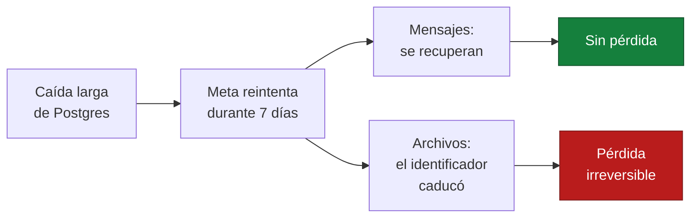

**Una caída larga pierde archivos aunque no pierda mensajes.**

De aquí sale la prioridad de las alertas: **la alerta de webhook caído tiene un reloj de 7 días**, no es un aviso de cortesía. Es la única alerta del sistema que protege algo que no se puede recuperar.

### 8.3 Por qué casi nada más se pierde

Tres decisiones de diseño explican por qué el resto de la tabla dice "automática".

**1. El evento se guarda crudo antes de responder 200** (ADR-005). Si el consumidor falla, el evento sigue ahí. Si el guardado falla, no hay 200 y Meta reintenta. **El mensaje está a salvo desde el primer momento.**

**2. La unicidad vive en la base, no en el transporte** (ADR-005). Reprocesar un evento mil veces produce el mismo resultado que procesarlo una. Eso vuelve la recuperación trivial: se reprocesa todo sin pensar en qué se procesó ya.

**3. Las tres colas tienen tolerancias separadas** (§3.4). Un adjunto de 100 MB atascado no detiene mensajes de texto; una caída del modelo no atrasa la recepción.

### 8.4 Los fallos parciales, que son los difíciles

Un servicio caído es fácil: se nota. Lo difícil es cuando algo funciona a medias.

| Fallo parcial | Qué pasa | Cómo se maneja |
| --- | --- | --- |
| **Meta responde pero tarda** | El asesor espera | Tiempo límite acotado; el mensaje queda en error reintentable |
| **La llamada a Meta expira** | **No se sabe si el mensaje salió** | Ver abajo |
| **El modelo responde lento** | El contacto espera al agente | Tras dos fallos, escala a una persona |
| **Realtime acepta la conexión pero no entrega** | La bandeja parece congelada | La consulta de 60 s la recoge; se registra |
| **Postgres lento, no caído** | Todo se arrastra | Tiempo límite de 60 s en Hyperdrive |
| **La cola entrega dos veces** | Nada | Unicidad en la base |

**El caso del tiempo límite al enviar merece atención.** Si la llamada a Meta expira, el sistema no sabe si el mensaje salió. Reintentar puede duplicarlo; no reintentar puede perderlo.

ADR-012 lo resolvió así: **la decisión la toma el asesor, informado.** El mensaje queda en error con un texto que dice que puede haberse enviado. Es la opción honesta, y es preferible a que el sistema adivine.

**El agente no tiene esa salida** —su cola reintenta sola—, y por eso necesita la clave de idempotencia `(organization_id, conversation_id, inbound_message_id)` que ADR-014 definió. Sin ella, el contacto recibiría la respuesta dos veces.

### 8.5 El fallo más disruptivo no es el más técnico

Vale la pena señalarlo porque es contraintuitivo.

**Si Resend falla, todo el sistema funciona perfectamente y el negocio se detiene.** No entran clientes nuevos: sin correo no hay invitación, y sin invitación el primer administrador de una organización no entra (`RF-PLT-ORG-06`).

Es la pieza más modesta de la arquitectura y la más crítica para la operación comercial.

**La mitigación ya estaba en los requisitos por otra razón:** `RF-PLT-USR-03` y `RF-PLT-USR-04` permiten generar un enlace nuevo que el operador copia y envía por otro medio. Un fallo de Resend tiene salida manual — lo que lo convierte en una molestia en vez de un bloqueo.

### 8.6 Degradación del tiempo real

El tiempo real es la pieza cuyo fallo mejor se tolera, y es deliberado.

| Estado | Qué ve el asesor | Latencia |
| --- | --- | --- |
| Normal | Mensajes al instante | < 2 s |
| Canal caído | Todo funciona, más lento | Hasta 60 s |
| Aviso perdido | Igual | Hasta 60 s |

**El aviso nunca es el único camino por el que un dato llega a la pantalla** (ADR-008). La consulta de respaldo cada 60 segundos, la recarga al recuperar el foco y la recarga al reconectar hacen que un fallo del canal se vea como lentitud, no como "el CRM no funciona".

**El riesgo real no es que el canal se caiga** —eso se nota y se recupera—, **sino que falle en silencio.** Un aviso que no llega se compensa, pero si deja de ser raro hay un problema que la consulta de respaldo está escondiendo. Por eso se registra cada fallo de publicación (§10).

### 8.7 Qué pasa con una organización suspendida

No es un fallo, pero se comporta como uno desde dentro y conviene tenerlo en la misma tabla mental.

| Camino | Comportamiento |
| --- | --- |
| Entrada de mensajes | **Sigue funcionando.** Se guardan igual (`RF-CNV-16`) |
| Salida de mensajes | Bloqueada (`RF-AUT-07`) |
| Acceso de usuarios | Bloqueado, con efecto inmediato |
| Agente | No responde — pasa por la misma verificación |

**La suspensión bloquea la salida, no la entrada.** Un negocio suspendido no pierde los mensajes de sus clientes; al reactivar, encuentra todo.

### 8.8 Qué hacer en un incidente

El orden importa, porque el reloj de 7 días corre solo para una cosa.

1. **¿El webhook recibe eventos?** Es lo primero. Si no, el reloj de los archivos está corriendo.
2. **¿La cola de mensajes fallidos tiene elementos?** Cada uno es un mensaje que no llegó a la bandeja.
3. **¿Postgres responde?** Casi todo lo demás depende de esto.
4. El resto puede esperar: Realtime, R2 y el agente degradan sin perder nada.

**La consola es la primera herramienta de diagnóstico.** `RF-PLT-WA-05` ya muestra último evento, eventos en 24 horas y errores recientes por organización, derivados de la tabla de eventos. Es trabajo que no hay que repetir en un panel aparte.

### 8.9 Lo que este diseño no cubre

Honestidad sobre los límites:

| No cubierto | Por qué |
| --- | --- |
| Recuperación ante desastre con objetivo de tiempo | No hay requisito. Las copias del plan Pro son el punto de partida |
| Conmutación automática entre proveedores | Desproporcionado para el volumen y el equipo |
| Degradación de solo lectura si Postgres falla | Sin base no hay nada que leer: todo vive ahí |
| Reintento automático de un envío con tiempo límite | Deliberado: duplicaría mensajes. Lo decide el asesor |

**Una copia de seguridad que nunca se probó no es una copia.** ADR-011 ya lo exige: hay que verificar al menos una restauración antes del piloto.

---

## 9. Despliegue

Qué entornos existen, qué hay en cada uno, cómo se despliega y cómo se revierte.

**El criterio que la ordena:** con dos personas a tiempo parcial, cada pieza que haya que operar se paga en tiempo que no está disponible. Por eso **dos entornos, no tres**, y despliegue automático en lugar de un procedimiento manual que alguien tenga que recordar.

### 9.1 Dos entornos

| Recurso | Desarrollo | Producción |
| --- | --- | --- |
| Proyecto de Supabase | Propio, plan gratuito | Propio, **plan Pro** |
| Workers (aplicación y API) | Propios | Propios |
| Las tres colas | Propias | Propias |
| Bucket de R2 | Propio | Propio |
| Dominio de correo | Subdominio de pruebas | Dominio propio |
| Número de WhatsApp | Número de pruebas de Meta | Números del portafolio de Numi |
| Organización de Anthropic | Datos de prueba | **Con preparación para HIPAA** |

**Nada se comparte entre entornos.** Un error en desarrollo no puede tocar datos de clientes ni enviar mensajes reales por WhatsApp. Es la razón de que cada entorno tenga su propio número de Meta y su propio bucket.

**Por qué no hay entorno de pruebas intermedio.** Sería una pieza sin problema que resolver con dos personas (`CLAUDE.md` §4, regla 9). ADR-011 dejó la señal para revisarlo: **cuando haya un cliente de pago**, probar en producción deja de ser aceptable.

**Por qué producción usa el plan Pro.** La razón decisiva no es el rendimiento: el plan gratuito **pausa el proyecto tras una semana de inactividad**. Para un piloto que empieza el 1 de diciembre, con días previos de poca actividad, eso es un fallo en el peor momento posible. Además da copias de seguridad.

### 9.2 Cómo se despliega

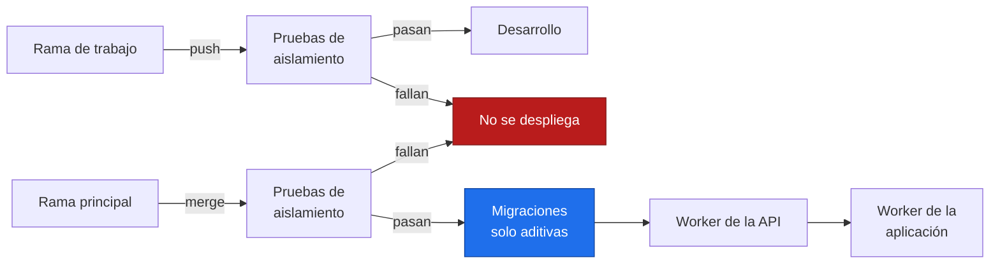

**Las pruebas de aislamiento corren antes de cada despliegue** (ADR-006, ADR-011). Si alguna falla, no se despliega. `RF-TRV-01` es el único requisito de `CLAUDE.md` §8 que se puede verificar automáticamente en cada cambio — desperdiciarlo sería absurdo.

**El orden importa cuando la API y la aplicación cambian juntas.** Las migraciones primero, luego la API, luego la aplicación. La razón: una aplicación nueva pidiendo un endpoint que todavía no existe da errores inmediatos y visibles; una API nueva sirviendo a una aplicación vieja no, porque los cambios son aditivos. **Se despliega en el orden que deja la ventana de incompatibilidad del lado seguro.**

### 9.3 Migraciones: solo aditivas

Es la regla que hace posible revertir.

| Permitido | Prohibido durante el MVP |
| --- | --- |
| Agregar tablas | Borrar tablas |
| Agregar columnas | Renombrar columnas |
| Agregar índices y políticas | Borrar columnas |

**Las migraciones son archivos versionados**, aplicados antes del despliegue del código.

**Por qué esta disciplina.** Con dos personas y siete semanas, una migración destructiva mal aplicada en producción es una pérdida de datos sin vuelta atrás. Y hay una razón estructural más: **un código anterior sigue funcionando sobre un esquema con columnas de más, pero no sobre uno al que le falta algo.** Es lo que hace que la reversión del código sea segura.

**Toda tabla nueva necesita su política de RLS en la misma migración.** La prueba 6 de §7.9 es lo que vuelve visible ese olvido — y es exactamente como ocurren los fallos de aislamiento: alguien agrega una tabla en noviembre sin acordarse.

### 9.4 Reversión

| Qué | Se revierte | Cómo |
| --- | --- | --- |
| Código del Worker | **Sí** | Cloudflare permite volver a un despliegue anterior |
| Migraciones | **No** | Por eso son solo aditivas |
| Datos | Por copia de seguridad | Plan Pro; implica pérdida desde el último punto |

**La reversión cubre el código, no el esquema.** Es la asimetría que explica toda la sección 9.3: como las migraciones no se revierten, se diseñan para no necesitarlo.

**Una copia de seguridad que nunca se probó no es una copia.** ADR-011 lo exige y vale la pena repetirlo: hay que verificar al menos una restauración antes del piloto. Es una tarea de una hora que evita descubrir el problema el día que importa.

### 9.5 La configuración que no está en el código

Esta es la parte que más se olvida, porque **no falla de forma visible**. Va en el repositorio como documento de puesta en marcha y se verifica a mano en cada entorno.

| Verificación | Si está mal |
| --- | --- |
| **"Allow public access" de Realtime desactivado** | Los canales son públicos y el aislamiento del tiempo real **no existe** |
| **Los tres roles creados, ninguno con `bypassrls`** | La capa de RLS es decorativa |
| **`max_size` de Hyperdrive en 40** | Bajo carga, Hyperdrive abre más conexiones de las que Supabase acepta (§11.2) |
| `sessions.timebox` 12 h, `inactivity_timeout` 30 min | Sesiones más largas de lo decidido |
| SMTP propio apuntando a Resend | Las invitaciones salen del remitente equivocado o no salen |
| Rol dedicado de Hyperdrive con privilegios mínimos | La API se conecta con más permisos de los necesarios |
| Preparación para HIPAA en Anthropic | El contenido de salud queda en registros de un tercero |

**Las tres primeras son las graves**, y comparten una propiedad: su fallo es silencioso. Un canal público no da error — simplemente deja de aislar.

### 9.6 El orden de puesta en marcha

Hay dependencias externas con tiempos de espera que el equipo no controla. Conviene empezarlas pronto.

| Orden | Qué | Por qué urge |
| --- | --- | --- |
| 1 | **Configurar Resend: SPF, DKIM y DMARC** | La propagación de DNS no depende del equipo. **Sin correo no hay alta de organizaciones**. ADR-011 recomienda la semana del 19 de octubre |
| 2 | **Verificación de negocio ante Meta** | Ruta crítica del proyecto desde el 14 de octubre; sin ella el piloto queda limitado a 2 clientes |
| 3 | Preparación para HIPAA en Anthropic | Autoservicio e inmediato, pero **permanente**: lo decide un representante legal |
| 4 | Roles, políticas y pruebas de aislamiento | Deben existir **desde la primera migración**, no en la última semana |
| 5 | Probar una restauración de copia | Antes del piloto |

**El punto 4 merece énfasis.** ADR-006 lo advirtió: si las políticas se dejan para el final, habrá consultas escritas suponiendo que no existen. El reparto de `docs/01_definicion_mvp_v2.2.md` §9 asigna a Franco la base y el aislamiento, y §10 reserva la última semana de noviembre para pruebas — pero las políticas no son trabajo de la última semana.

### 9.7 Lo que este diseño de despliegue no cubre

| No cubierto | Por qué |
| --- | --- |
| Despliegue gradual o por porcentaje | Desproporcionado para el volumen |
| Revisión de código obligatoria | Con dos personas sería ceremonia. ADR-011 la marca como necesaria **si el equipo crece** |
| Entorno de pruebas intermedio | Se revisa cuando haya un cliente de pago |
| Reversión automática ante errores | No hay señal confiable para dispararla a este volumen |

---

## 10. Observabilidad

Qué se registra, qué se vigila y qué avisa. **El objetivo es operar un piloto de una semana con dos personas, no construir un sistema de monitoreo.**

### 10.1 La restricción que define esta sección

Lo que no se registra es tan importante como lo que sí, y no es una preferencia: es `RF-TRV-07` y `RF-PLT-USO-04`.

| Se registra | **Nunca** se registra |
| --- | --- |
| Toda petición: ruta, organización, usuario, resultado, duración | Texto de mensajes |
| Todo evento del webhook: identificador, organización, resultado | Nombres o teléfonos de contactos |
| Todo error, con su contexto | Tokens, ni completos ni parciales |
| Fallos de publicación de avisos | Contenido de archivos, ni nombres que identifiquen a una persona |

**La forma de cumplirlo es que el registro reciba identificadores, no objetos.**

Registrar un objeto de evento completo "para depurar" es exactamente como se filtra contenido sensible a los registros. No ocurre por mala fe: ocurre a las dos de la mañana, depurando un fallo, con un `console.log` del evento entero. Por eso la regla tiene que ser estructural —las funciones de registro aceptan identificadores— y no una advertencia en un documento.

### 10.2 Las tres alertas mínimas

En orden de urgencia, y la razón del orden importa.

| # | Alerta | Cuándo | Por qué |
| --- | --- | --- | --- |
| 1 | **Webhook caído** | Sin eventos recibidos durante 2 h en horario laboral | **Tiene un reloj de 7 días.** Pasado ese plazo los identificadores de archivo caducan y los archivos se pierden para siempre |
| 2 | **Cola de mensajes fallidos con elementos** | Cualquier elemento | Un evento que agotó sus reintentos es un mensaje que no llegó a la bandeja (`RF-TRV-02`) |
| 3 | **Errores de la API sobre lo normal** | Umbral a calibrar en la primera semana | Señal temprana de cualquier otra cosa |

**Las dos primeras protegen requisitos que no se negocian. La tercera es higiene.**

La número 1 es la única alerta del sistema que protege algo irreversible (§8.2). Todas las demás avisan de cosas que se recuperan solas; esta avisa de un reloj corriendo.

**Por qué "2 horas en horario laboral" y no un umbral más agresivo:** con 500 conversaciones al mes por negocio, dos horas sin ningún evento entrante es anómalo pero no imposible un martes tranquilo. Un umbral más corto produciría falsas alarmas, y una alerta que suena sin motivo se empieza a ignorar — que es la peor forma de perder la única alerta que importa.

### 10.3 Qué agrega el agente

ADR-011 se escribió antes de ADR-014, así que no cubre esta pieza. Dos señales que conviene vigilar, **ninguna como alerta**:

| Señal | Qué indica | Por qué no es alerta |
| --- | --- | --- |
| Cola del agente con elementos acumulados | El modelo responde lento o falla | Degrada sin perder nada: las conversaciones escalan a personas |
| Tasa de escaladas alta (`RF-MET-09` bajo) | El agente no está aportando | Es una señal de producto, no de operación |

**El agente es la única pieza del sistema cuyo mal funcionamiento no es una urgencia**, y eso es consecuencia directa del diseño de ADR-014: si falla dos veces, escala a una persona. El modo degradado del agente es exactamente el comportamiento del sistema sin agente.

**Lo que sí hay que vigilar es el costo**, que es la única partida variable (§1.6). No es una alerta técnica: es revisar el consumo durante el piloto.

### 10.4 Cómo se observa, con el mínimo esfuerzo

Tres piezas, ninguna nueva:

**1. Registros de Workers.** Vienen con la plataforma.

**2. La consola es la primera herramienta de operación.** `RF-PLT-WA-05` ya muestra último evento, eventos en 24 horas y errores recientes por organización, derivados de la tabla de eventos. **Es trabajo que no hay que repetir en un panel aparte** — y tiene la ventaja de que un operador puede diagnosticar un problema de un cliente sin acceso a registros técnicos.

**3. Una verificación periódica externa** que consulte un endpoint de salud y avise si no responde.

La tercera merece una explicación: **es lo único que detecta una caída total.** Si todo está caído, no hay nada adentro que envíe la alerta. Es la pieza que cubre el punto ciego de las otras dos.

### 10.5 Qué mirar primero en un incidente

El mismo orden de §8.8, porque solo un reloj corre:

1. **¿El webhook recibe eventos?** Si no, el reloj de los archivos está corriendo.
2. **¿La cola de mensajes fallidos tiene elementos?** Cada uno es un mensaje que no llegó.
3. **¿Postgres responde?** Casi todo depende de esto.
4. El resto puede esperar: Realtime, R2 y el agente degradan sin perder nada.

### 10.6 Antes del piloto

Dos mediciones que ya exigen otras decisiones y que conviene no dejar para el final:

| Qué | Por qué | Decisión |
| --- | --- | --- |
| **Medir V30 con datos realistas** — 6.000 conversaciones y 60.000 mensajes en una organización | Es una tarea de una hora que evita descubrir el problema con un cliente delante | ADR-013 |
| **Probar una restauración de copia** | Una copia que nunca se probó no es una copia | ADR-011 |

**Calibrar el umbral de la alerta 3 durante la primera semana**, con tráfico real. Antes de eso no hay con qué compararlo.

### 10.7 Lo que no se construye

| No se construye | Por qué |
| --- | --- |
| Panel de métricas técnicas | La consola ya cubre lo que un operador necesita |
| Trazas distribuidas | Dos Workers y una base: el registro de petición alcanza |
| Agregador de registros externo | Los de Workers bastan para el piloto. Se revisa si el volumen de incidentes lo justifica |
| Alertas por organización | A 20 negocios, un problema de uno se ve en la salud del webhook de la consola |

**El criterio es el de `CLAUDE.md` §4, regla 9:** cada pieza debe justificar qué problema concreto resuelve hoy. Un sistema de observabilidad que nadie tiene tiempo de mirar es peor que tres alertas que suenan cuando importa.

---

## 11. Escalabilidad

Esta sección se adelanta al orden del índice porque responde a una pregunta directa: **¿las decisiones tomadas sostienen un sistema escalable?** La respuesta corta es sí, con dos correcciones que esta auditoría encontró y que hay que aplicar antes del piloto.

El método: tomar cada límite duro de cada pieza, verificarlo en documentación oficial, y compararlo con el volumen proyectado de §1.1. No sirve decir "Cloudflare escala"; sirve saber en qué número exacto deja de alcanzar cada cosa.

### 11.1 Los límites verificados

Todos consultados el 2026-10-15 en documentación oficial.

| Pieza | Límite duro | Volumen proyectado (20 negocios) | Margen |
| --- | --- | --- | --- |
| Throughput de un número de Meta | 80 mps, ampliable a 1.000 | 0,95 mps en pico | **84×** |
| Números por portafolio de Meta | **20 verificado** | 20 negocios | **1× — sin margen** |
| Cloudflare Queues | 1M operaciones al mes incluidas | ~400.000 al mes | 2,5× |
| Hyperdrive, conexiones por configuración | **~100 en plan de pago** | — | Ver 11.2 |
| Supabase Micro, conexiones directas | **60** | — | Ver 11.2 |
| Supabase Realtime, conexiones concurrentes | 200 | ~60 asesores | 3,3× |
| Resend, correos | 3.000 al mes, **100 al día** | Decenas al mes | Amplio, salvo altas masivas |
| Duración máxima de consulta en Hyperdrive | 60 s | V30 objetivo < 2 s | 30× |

### 11.2 Hallazgo 1: Hyperdrive puede abrir más conexiones de las que Supabase acepta

**Este es el problema real que encontró la auditoría, y no está registrado en ningún ADR.**

Los números, ambos verificados:

- **Hyperdrive en plan de pago: hasta ~100 conexiones** al origen por configuración, y la documentación advierte que *"these counts may occasionally be exceeded"* — `max_size` es un límite blando.
- **Supabase Micro —el tamaño de cómputo que incluye el plan Pro que fijó ADR-011— acepta 60 conexiones directas.**

Y ADR-003 fijó usar la **cadena Direct**, no la agrupada, porque Hyperdrive hace su propio agrupamiento.

**100 contra 60.** Bajo carga suficiente, Hyperdrive puede intentar abrir más conexiones de las que la base acepta, y las que sobran fallan. No es un problema de rendimiento que se degrade con suavidad: son errores de conexión.

**Por qué no va a pasar en el piloto:** con 0,95 mensajes por segundo en pico y transacciones cortas (ADR-006), el agrupamiento no necesita acercarse ni de lejos a 60 conexiones. El riesgo es teórico hoy.

**Por qué hay que arreglarlo igual:** cuesta una línea de configuración y evita un fallo que aparecería bajo carga, que es exactamente cuando menos se quiere depurar.

**Corrección a aplicar:** fijar explícitamente `max_size` de la configuración de Hyperdrive **por debajo del límite de la base** —un valor de 40 deja margen para el límite blando y para las conexiones que el equipo use desde fuera del Worker (migraciones, inspección)—. No dejarlo en el valor por defecto.

**Señal para revisarlo:** al subir el tamaño de cómputo de Supabase, subir `max_size` en la misma proporción. Small acepta 90 conexiones directas, Medium 120, Large 160.

### 11.3 Hallazgo 2: el techo de 20 negocios no tiene margen

§1.1 ya lo registró, pero conviene decirlo aquí con todas las letras porque es **el límite que se alcanza primero, por un margen enorme**:

| Límite | Se alcanza en |
| --- | --- |
| **Números por portafolio de Meta** | **20 negocios** |
| Conexiones de Postgres | ~50 organizaciones (ADR-003, ADR-011) |
| Conexiones de Realtime | ~200 asesores concurrentes |
| Queues incluidas en el plan | ~50 negocios |

**El primer cuello de botella del sistema no es técnico: es un permiso de Meta.** Y no se resuelve con dinero ni con arquitectura —se resuelve obteniendo el rol de Tech Provider, que ADR-001 ya fijó como destino y que el proyecto tiene como ruta crítica desde el 14 de octubre.

Esto tiene una consecuencia de diseño que vale la pena hacer explícita: **no tiene sentido optimizar el sistema para más de 20 negocios mientras ese permiso no exista.** Cualquier trabajo de escalabilidad que se haga antes es trabajo contra un techo que no se puede levantar por la vía técnica. Esto respalda lo que `CLAUDE.md` §4 regla 9 ya pedía.

### 11.4 Qué sostiene bien el diseño

Revisadas las 14 decisiones, estas propiedades escalan sin trabajo adicional:

| Propiedad | Por qué escala | Decisión |
| --- | --- | --- |
| **Sin estado en memoria** | Ninguna instancia guarda nada entre peticiones; agregar capacidad es automático | ADR-003 |
| **Unicidad en la base, no en el transporte** | La deduplicación funciona igual con 1 o con 1.000 mensajes por segundo, y no depende de cuántos consumidores haya | ADR-005 |
| **Orden por marca de tiempo de Meta** | No depende del orden de llegada ni de cuántos consumidores procesen en paralelo | ADR-005 |
| **`organization_id` como primera columna de cada índice** | El costo de una consulta depende del tamaño de *una* organización, no del total | ADR-006, ADR-013 |
| **Aislamiento por permisos de base** | `app_platform` sin acceso a mensajes no deja de cumplirse porque crezca el sistema | ADR-006 |
| **El aviso no es el dato** | El canal de tiempo real transporta identificadores; su carga no crece con el tamaño de los mensajes | ADR-008 |
| **Tres colas con tolerancias distintas** | Un fallo lento del agente o un archivo de 100 MB no atrasan los mensajes entrantes | ADR-005, ADR-014 |

La más importante es la cuarta. **El costo de las consultas depende del tamaño de una organización, no del total**, lo que significa que 100 negocios de 500 conversaciones cada uno no son más lentos de consultar que 10 — siempre que los índices estén bien. Es la propiedad que hace que este diseño no se degrade con el número de clientes.

### 11.5 Dónde se rompería primero, en orden

Suponiendo resuelto el permiso de Meta:

| Orden | Qué cede | Cuándo | Qué cuesta arreglarlo |
| --- | --- | --- | --- |
| 1 | **Conexiones de Postgres** | ~50 organizaciones | Subir el tamaño de cómputo: ~15 USD al mes a Small, ~60 a Medium. Cambio de configuración, menos de 2 minutos de interrupción |
| 2 | **Correos de Resend** | Altas masivas el mismo día | Plan Pro, 20 USD al mes |
| 3 | **Conexiones de Realtime** | ~200 asesores concurrentes | Plan superior de Supabase |
| 4 | **Consultas de métricas** | ~20.000 conversaciones por organización, unos 3 años | Índices primero; resúmenes precalculados solo si se mide que hacen falta (ADR-013) |
| 5 | **Operaciones de Queues** | Más allá de 1M al mes | 0,40 USD por millón adicional |

**Ninguno es un rediseño.** Los cinco se resuelven con configuración o con dinero, en cantidades pequeñas. Eso es lo que distingue un diseño que escala de uno que no: no que aguante todo, sino que **lo que cede se arregle sin reescribir nada.**

### 11.6 Lo que exigiría replantear el diseño

Honestidad sobre los límites: tres escenarios donde lo decidido dejaría de servir.

| Escenario | Qué se rompe | Por qué |
| --- | --- | --- |
| **Difusión o campañas masivas** | El envío síncrono de ADR-012 | Está diseñado para una persona escribiendo. Mil mensajes de golpe necesitan una cola de salida. ADR-012 ya lo anotó; hoy está fuera del MVP |
| **Un cliente mucho mayor que el resto** | El supuesto de 500 conversaciones al mes | Un negocio con 50.000 conversaciones al mes cambiaría el perfil de las consultas. ADR-006 ya prevé el camino: mover esa organización a su propia base, que RLS vuelve más fácil |
| **Varios canales además de WhatsApp** | Nada estructural | La interfaz de canal de ADR-001 y el aviso genérico de ADR-008 ya lo contemplan. Es trabajo, no rediseño |

El segundo es el más probable y el mejor preparado: el aislamiento por `organization_id` en cada consulta es precisamente lo que permite separar un cliente sin tocar el resto.

### 11.7 Correcciones a aplicar antes del piloto

Resumen accionable de esta auditoría:

1. **Fijar `max_size` de Hyperdrive en 40**, por debajo de las 60 conexiones directas de Supabase Micro. Va en la lista de puesta en marcha de ADR-011, junto a las otras verificaciones manuales.
2. **Al cambiar el tamaño de cómputo de Supabase, revisar `max_size`** en la misma operación. Son dos números que tienen que moverse juntos.
3. **Medir V30 con datos realistas** antes del piloto, como ya exigía ADR-013: 6.000 conversaciones y 60.000 mensajes en una organización.

Ninguna de las tres es trabajo de arquitectura. Las tres son configuración o medición.

---

## 12. Trazabilidad

Cada requisito enlazado con el componente que lo cumple. La sección sirve para dos cosas: verificar que **nada quedó sin dónde cumplirse**, y verificar que **no hay nada diseñado que no corresponda a ningún requisito** (`CLAUDE.md` §11).

**Totales verificados contra los documentos fuente:**

| Documento | Requisitos | P0 | P1 |
| --- | --- | --- | --- |
| `docs/02_documento_maestro_v1.1.md` (CRM) | 63 | **63** | — |
| `docs/03_consola_plataforma_v1.1.md` (consola) | 52 | **47** | 5 |
| ADR-014 (agente) | 1 nuevo | 1 | — |
| **Total P0** | | **111** | |

Todos los requisitos del CRM son P0 (`docs/02` §4).

### 12.1 CRM — acceso y sesión

| Requisito | Componente | Sección |
| --- | --- | --- |
| `RF-AUT-01` Inicio de sesión | Identidad + Supabase Auth | §4.3, §7.1 |
| `RF-AUT-02` Cierre de sesión | Identidad | §5.4 |
| `RF-AUT-03` Invitación por correo | Identidad + Resend | §6.4 |
| `RF-AUT-04` Restablecer contraseña | Identidad + Resend | §6.4 |
| `RF-AUT-05` Usuario desactivado | Identidad, en cada petición | §5.4, §7.1 |
| `RF-AUT-06` Sesión expirada | Cliente de la API | §5.4 |
| `RF-AUT-07` Organización suspendida | Identidad, en cada petición | §6.5, §8.7 |

**`RF-AUT-05` y `RF-AUT-07` tienen efecto inmediato** porque se consultan en cada petición, no en el token (§5.4).

### 12.2 CRM — conversaciones

| Requisito | Componente | Sección |
| --- | --- | --- |
| `RF-CNV-01` Recibir y mostrar sin recargar | Canal → Conversaciones → Realtime | §6.1 |
| `RF-CNV-02` a `05` Lista, orden, filtros, búsqueda | Conversaciones | §4.3, §5.5 |
| **`RF-CNV-06` Orden por hora de envío** | Conversaciones | §6.1 |
| `RF-CNV-07` Enviar texto | Conversaciones + Canal | §6.2 |
| **`RF-CNV-08` Ventana de 24 h** | Canal, antes de enviar | §6.2 |
| **`RF-CNV-09` Estados del mensaje** | Conversaciones | §6.2 |
| `RF-CNV-10` Marcadores de tipo no mostrado | Conversaciones | §4.3 |
| `RF-CNV-10a` a `10e` Adjuntos | Conversaciones + R2 | §7.5 |
| `RF-CNV-11` Tomar conversación | Asignación | §6.3 |
| `RF-CNV-12` Asignación automática | Asignación | §6.3 |
| `RF-CNV-13` Cerrar y reabrir | Conversaciones | §4.3 |
| `RF-CNV-14` Cambiar estado desde la conversación | Contactos | §4.3 |
| `RF-CNV-15` Tiempo real y contador | Realtime + frontend | §5.6 |
| **`RF-CNV-16` Suspendida: se guarda igual** | Conversaciones | §8.7 |

### 12.3 CRM — contactos, estados, métricas, usuarios, configuración

| Requisito | Componente | Sección |
| --- | --- | --- |
| `RF-CON-01` a `09` Contactos | Contactos | §4.3 |
| `RF-EST-01` a `04` Estados del contacto | Contactos | §4.3 |
| `RF-MET-01` a `08` Métricas | Métricas, vistas SQL | §4.3 |
| `RF-MET-09` **Resueltas por el agente** (nuevo) | Métricas + Agente | ADR-014 |
| `RF-USR-01` a `08` Usuarios del negocio | Identidad | §4.3 |
| `RF-CFG-01` a `03` Configuración | Identidad, Canal, Asignación | §4.3 |
| Configuración del agente (nuevo) | Agente | §5.8 |

**`RF-CON-07`** —teléfono único por negocio— se cumple por restricción de unicidad, no por validación en la interfaz.

### 12.4 CRM — transversales

| Requisito | Dónde se cumple | Sección |
| --- | --- | --- |
| **`RF-TRV-01` Aislamiento** | Cinco capas + siete pruebas automáticas | §7.1, §7.9 |
| **`RF-TRV-02` Webhook confiable** | Firma + guardado previo al 200 + unicidad | §6.1 |
| `RF-TRV-03` Rendimiento | Presupuesto de latencia; búsqueda en el servidor | §1.3, §5.5 |
| `RF-TRV-04` Estados de interfaz | Componentes compartidos | §5.7 |
| `RF-TRV-05` Formato regional | Formateo centralizado | §5.7 |
| `RF-TRV-06` Accesibilidad | Componentes desde la base | §5.7 |
| **`RF-TRV-07` Datos sensibles acotados** | Permisos de `app_platform` | §7.3, §10.1 |
| `RF-TRV-08` Correos propios | Resend con dominio propio | §9.6 |

### 12.5 Consola — los 47 P0

| Familia | Requisitos | Componente | Sección |
| --- | --- | --- | --- |
| `RF-PLT-ACC-01` a `05` | 5 | Identidad + Auth (TOTP) | §7.4 |
| `RF-PLT-ORG-01` a `11` | 11 | Identidad | §6.4 |
| `RF-PLT-EST-01` a `06` | 6 | Identidad | §6.5 |
| `RF-PLT-USR-01` a `07` | 7 | Identidad + Resend | §6.4 |
| `RF-PLT-WA-01` a `07` | 7 | Canal | §4.5 |
| `RF-PLT-USO-01`, `04` | 2 | Consola, sin contenido | §7.4 |
| `RF-PLT-AUD-01`, `02`, `03`, `05` | 4 | Auditoría | §4.3 |
| `RF-PLT-SEG-01` a `05` | 5 | Identidad, Canal, Resend | §7.3, §7.7 |
| **Total** | **47** | | |

**Fuera del MVP, ya marcados P1 en el documento** y que no se reabren: `RF-PLT-ORG-12`, `RF-PLT-USO-02`, `RF-PLT-USO-03`, `RF-PLT-AUD-04`, `RF-PLT-WA-08`, más las vistas P10 y P30.

**`RF-PLT-WA-08`** —registro integrado de Meta— sube a P0 al obtener el rol de Tech Provider (ADR-001).

### 12.6 Los nueve que no se negocian

`CLAUDE.md` §8 los separa del resto. Aquí está dónde se cumple cada uno y **qué lo garantiza**, que es la pregunta que importa.

| # | Requisito | Garantizado por | Verificable |
| --- | --- | --- | --- |
| 1 | Aislamiento entre negocios | RLS + filtro + permisos de rol | **Sí** — 7 pruebas automáticas |
| 2 | Webhook sin duplicados | Unicidad `(organization_id, wamid)` en la base | **Sí** — restricción |
| 3 | Webhook sin pérdidas | Guardado crudo antes del 200 + reintentos de Meta | Parcial — por diseño |
| 4 | Orden por hora de envío | Marca de tiempo de Meta con desempate | Sí — prueba funcional |
| 5 | Ventana de 24 h | Verificación local + código de Meta | Sí — prueba funcional |
| 6 | Estados del mensaje | Progresión que no retrocede | Sí — prueba funcional |
| 7 | Datos sensibles fuera de consola | **Permisos**: `app_platform` sin acceso a mensajes | **Sí** — prueba 5 |
| 8 | Tokens cifrados | AES-GCM, clave fuera de la base | Sí — inspección |
| 9 | Rol verificado en cada petición | Consulta en base, no en el token | Sí — prueba funcional |

**Los números 1, 2 y 7 son estructurales:** no dependen de disciplina, sino de restricciones y permisos de la base. Son los tres que un error de código no puede romper.

### 12.7 Qué se diseñó sin requisito que lo pida

La pregunta inversa de `CLAUDE.md` §11. Revisadas las 14 decisiones, estas piezas no responden a ningún requisito explícito:

| Pieza | Por qué existe | ¿Se justifica? |
| --- | --- | --- |
| **Cola de eventos** | Separar la respuesta a Meta del procesamiento | Sí — es lo que hace cumplible `RF-TRV-02` |
| **Cola de archivos** | Que un adjunto de 100 MB no bloquee mensajes | Sí — `RF-CNV-10a` con el límite de 7 días |
| **Cola del agente** | Que el modelo no toque el camino de `RF-TRV-02` | Sí — ADR-014 |
| **Hyperdrive** | Agrupar conexiones desde Workers | Sí — restricción del runtime |
| **Tabla de eventos crudos** | Red de seguridad para reprocesar | Sí — y alimenta `RF-PLT-WA-05` |
| **Tres roles de base** | Convertir `RF-TRV-07` en imposibilidad | Sí |
| **Consulta de respaldo de 60 s** | Que un fallo del canal no se vea como caída | Sí — protege `RF-CNV-15` |

**Ninguna pieza sobra.** Las tres colas son el caso que más merecía revisión —parecen complejidad— y las tres existen porque tienen tolerancias de fallo incompatibles (§3.4).

### 12.8 Lo que esta trazabilidad revela

**Cobertura completa:** los 63 requisitos del CRM, los 47 P0 de la consola y el nuevo `RF-MET-09` tienen componente asignado. No hay requisito sin dónde cumplirse.

**Una corrección de hecho.** Al verificar los totales contra `docs/03`, ADR-002 decía *"44 requisitos en P0 y 8 en P1"*. El documento fuente dice **47 P0 y 5 P1** — ADR-002 contaba las dos vistas P1 como si fueran requisitos. La decisión de ADR-002 (consola completa) no cambia; el número sí, y queda corregido en el ADR. **El alcance de la consola es 3 requisitos mayor de lo que decía el ADR**, lo que refuerza su propia advertencia de calendario.

**Tres requisitos cambian de significado por decisiones posteriores**, y los documentos fuente deben actualizarse:

| Requisito | Qué cambió | Decisión |
| --- | --- | --- |
| `RF-CNV-10` | Antes cubría todos los tipos no mostrados; ahora solo video, sticker, ubicación y contacto | ADR-004 |
| `RF-MET-02` | La definición no cambia, pero con el agente en primera línea mide "cuánto tardó una persona en entrar", no "cuánto esperó el contacto" | ADR-014 |
| `RF-CFG-*` | Se agrega la configuración del agente | ADR-014 |

**Requisitos nuevos pendientes de incorporar al documento maestro:** `RF-CNV-10a` a `10e` (adjuntos, ADR-004) y `RF-MET-09` (ADR-014).

---

## Estado del documento

**Las 12 secciones están escritas.** Base: ADR-001 a ADR-014, todas aprobadas el 2026-10-15.

**Pendientes antes de darlo por terminado** (`CLAUDE.md` §7):

1. **Revisión independiente en sesión nueva** (`CLAUDE.md` §11). La sesión que escribió este documento no puede hacerla.
2. **Confirmar los cinco supuestos de §1.8** — el más influyente son los 20 mensajes por conversación, que multiplica todos los volúmenes.
3. **Resolver la elección de framework del frontend** (ADR-009), que depende de qué conoce Anthony.
4. **Actualizar `docs/01` a `docs/03`** con lo que cada ADR lista en sus consecuencias. Ninguna aplicada todavía.
