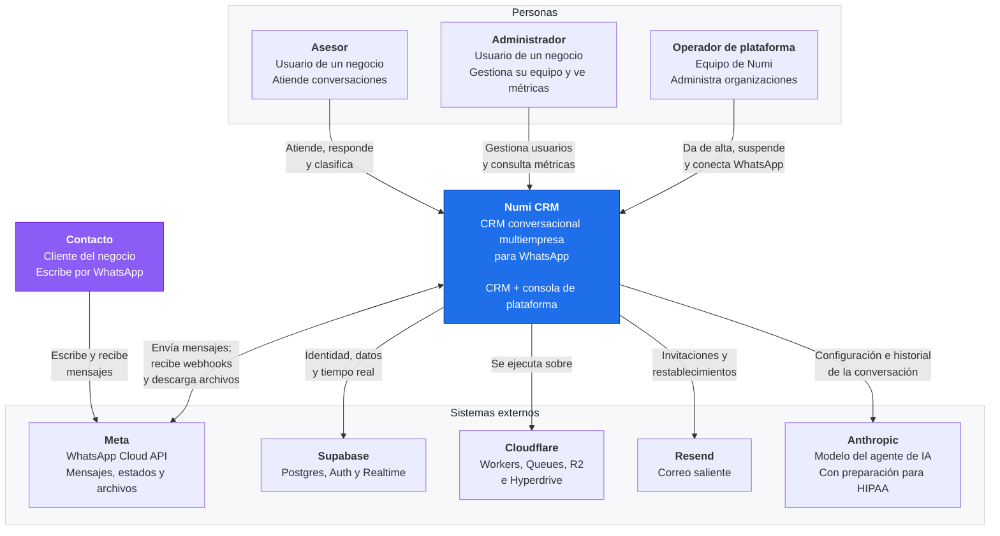

# Arquitectura de Numi CRM

- **Estado:** En construcción
- **Fecha:** 2026-10-15
- **Base:** ADR-001 a ADR-013, todas aprobadas el 2026-10-15
- **Alcance:** el MVP con fecha del 30 de noviembre de 2026 y el piloto del 1 de diciembre

Este documento describe la arquitectura del sistema completo: frontend, backend, datos, integraciones, seguridad y despliegue. Las decisiones ya están tomadas y registradas en `docs/adr/`; aquí se componen en un diseño único y se verifica que encajan.

**Cómo leer las citas.** Cada afirmación técnica remite a la decisión que la respalda (`ADR-00N`) o al requisito que la exige (`RF-XXX-NN`). Nada en este documento decide algo nuevo: si aparece una pieza que ningún ADR justifica, es un error de este documento.

| Sección | Estado |
| --- | --- |
| 1. Requisitos no funcionales | Escrita |
| 2. Contexto (C4 nivel 1) | Escrita |
| 3. Contenedores (C4 nivel 2) | Pendiente |
| 4. Componentes del backend (C4 nivel 3) | Pendiente |
| 5. Componentes del frontend (C4 nivel 3) | Pendiente |
| 6. Flujos críticos | Pendiente |
| 7. Multiempresa y seguridad | Pendiente |
| 8. Modos de falla | Pendiente |
| 9. Despliegue | Pendiente |
| 10. Observabilidad | Pendiente |
| 11. Escalabilidad | Pendiente |
| 12. Trazabilidad | Pendiente |

---

## 1. Requisitos no funcionales

Esta sección fija los números con los que se juzga el diseño. Sin ellos, "escalable" y "rápido" no significan nada y cualquier pieza se puede justificar.

**Advertencia sobre el origen de los números.** La tabla separa tres cosas que no tienen el mismo peso:

- **Exigido** — está escrito en un requisito o en una restricción de `CLAUDE.md` §8. No se negocia.
- **Derivado** — se calcula a partir de un dato exigido. El cálculo se muestra.
- **Supuesto** — lo propone este documento porque el diseño necesita un número y ninguna fuente lo da. **Franco y Anthony deben confirmarlo o corregirlo.** Un supuesto equivocado aquí invalida las conclusiones de la sección 11.

### 1.1 Volumen

| Qué | Valor | Origen | Fuente |
| --- | --- | --- | --- |
| Negocios en el piloto | **2 a 3** | Exigido | `docs/01_definicion_mvp_v2.2.md` §11 |
| Conversaciones por negocio al mes | **500** | Exigido | `CLAUDE.md` §8, "volumen de referencia" |
| Mensajes por conversación | **20** | Supuesto | Ninguna fuente lo fija. Ver cálculo abajo |
| Mensajes por negocio al mes | **10.000** | Derivado | 500 × 20 |
| Mensajes por negocio al año | **120.000** | Derivado | 10.000 × 12 |
| Contactos por negocio | **5.000** | Exigido | `RF-TRV-03` fija ese número como referencia de búsqueda |
| Usuarios por negocio | **3 a 10** | Supuesto | Un administrador más asesores; ningún documento lo fija |
| **Negocios a 12 meses** | **20** | **Supuesto con tope duro** | Ver abajo: el límite no es técnico |

**Sobre los 20 mensajes por conversación.** Es el supuesto más influyente de la tabla, porque multiplica todo lo demás. Una conversación de atención comercial en WhatsApp —consulta, respuesta, un par de aclaraciones, cierre— rara vez baja de 10 ni pasa de 40. Se toma 20 como punto medio. **Si el valor real resultara 50, los volúmenes de esta tabla se multiplican por 2,5** y la sección 11 debe rehacerse; sigue sin ser un problema para Postgres, pero conviene saberlo.

**Sobre los 20 negocios a 12 meses.** Este número no lo elige el equipo: lo impone Meta. ADR-001 registra que un portafolio verificado admite **20 números**, y que el modo transitorio del piloto aloja los números de los clientes en el portafolio de Numi. Mientras no se obtenga el rol de Tech Provider, **20 clientes es un tope duro, no una proyección de ventas**. Con Tech Provider cada negocio tiene su propio portafolio y el tope desaparece.

Dicho de otro modo: el primer límite de crecimiento de Numi CRM no es la base de datos ni el runtime, es un permiso de Meta. Esto se retoma en la sección 11.

**Volumen total del sistema a 12 meses, en el escenario de 20 negocios:**

| Qué | Cálculo | Valor |
| --- | --- | --- |
| Mensajes al mes | 20 × 10.000 | **200.000** |
| Mensajes al año | 20 × 120.000 | **2.400.000** |
| Contactos | 20 × 5.000 | **100.000** |

### 1.2 Carga derivada

Los números anteriores traducidos a lo que el sistema tiene que aguantar por segundo. **El cálculo honesto es el de hora pico, no el promedio**, porque un promedio diario reparte sobre 24 horas una carga que ocurre en 8.

| Qué | Cálculo | Valor |
| --- | --- | --- |
| Mensajes por segundo, promedio diario (20 negocios) | 200.000 ÷ 30 ÷ 86.400 | **0,08 mps** |
| Mensajes por segundo, hora pico | 200.000 ÷ 22 días hábiles ÷ 8 h ÷ 3.600, con factor de pico ×3 | **0,95 mps** |
| Peticiones a la API por segundo, hora pico | ≈ 10 × los mensajes (la bandeja consulta más de lo que escribe) | **≈ 10 rps** |

**Conclusión que gobierna el resto del documento: menos de 1 mensaje por segundo en el pico, con 20 negocios.** Es un número pequeño, y conviene tenerlo presente al leer cada decisión. Compararlo con lo que el stack admite:

| Límite disponible | Valor | Margen sobre el pico |
| --- | --- | --- |
| Throughput de un número de Meta | 80 mps (ADR-012) | **84×** |
| Cloudflare Queues, plan de pago | 1.000.000 operaciones al mes incluidas (ADR-005) | **5×** el volumen anual |
| Postgres con los índices de ADR-013 | Muy por encima | — |

El sistema está sobredimensionado para su carga por un margen amplio, y eso es deliberado: las piezas se eligieron por corrección y por costo de operación, no por capacidad (`CLAUDE.md` §4, regla 9). **Ninguna pieza de este diseño existe para absorber volumen.**

### 1.3 Latencia

| Qué | Objetivo | Origen | Fuente |
| --- | --- | --- | --- |
| Mensaje entrante visible en la bandeja | **≤ 5 s** | Exigido | `RF-TRV-03` |
| Búsqueda de contactos, 5.000 contactos | **< 1 s** | Exigido | `RF-TRV-03` |
| Respuesta al webhook de Meta | **Lo más corta posible** | Exigido | `RF-TRV-02`, ADR-005 |
| Vista de métricas (V30) | **< 2 s** | Supuesto | ADR-013 exige medirlo con datos realistas antes del piloto, pero no fija el umbral |
| Envío de un mensaje, respuesta al asesor | **< 1 s hasta "enviando"** | Derivado | ADR-012: se responde tras guardar, antes de llamar a Meta |

**El presupuesto de los 5 segundos**, repartido entre las piezas que ADR-005 y ADR-008 encadenan:

| Tramo | Presupuesto |
| --- | --- |
| Meta → webhook, validación de firma, guardado del evento crudo, respuesta 200 | ~200 ms |
| Espera en la cola y arranque del consumidor | ~500 ms |
| Procesamiento: resolver contacto y conversación, insertar el mensaje | ~300 ms |
| Publicación del aviso de Broadcast (ADR-008) | ~100 ms |
| Recepción en el navegador y consulta de los datos a la API | ~500 ms |
| **Total estimado** | **≈ 1,6 s** |
| **Margen sobre el objetivo** | **≈ 3,4 s** |

El margen es holgado a propósito. **El riesgo real no es la suma de estos tramos, sino la consulta de respaldo de 60 segundos de ADR-008**: si el Broadcast falla, el mensaje aparece en hasta 60 s, doce veces el objetivo. Por eso ADR-008 trata el fallo de notificación como un evento que se registra, y la sección 10 lo incluye entre lo que se vigila.

### 1.4 Disponibilidad y durabilidad

Aquí hay una asimetría que conviene declarar de frente, porque explica casi todas las decisiones de ADR-005:

| Propiedad | Objetivo | Por qué |
| --- | --- | --- |
| **No perder un mensaje entrante** | **Absoluto** | `RF-TRV-02`. Es condición de éxito del piloto (`docs/01_definicion_mvp_v2.2.md` §11) |
| **No duplicar un mensaje** | **Absoluto** | `RF-TRV-02`, por unicidad de `(organization_id, wamid)` en la base (ADR-005) |
| **Aislamiento entre negocios** | **Absoluto** | `RF-TRV-01`, verificado con pruebas automáticas |
| Disponibilidad de la interfaz del CRM | **99 % en horario laboral** | Supuesto. Ningún requisito la fija |
| Disponibilidad del webhook | Más alta que la del CRM | Derivado: si el CRM cae, un asesor espera; si el webhook cae, se acumula un reloj de 7 días (ADR-004) |

**Las tres primeras filas no son objetivos de porcentaje, son invariantes.** Un 99,9 % de mensajes no perdidos sería un fracaso: significaría 200 mensajes perdidos al mes con 20 negocios.

**Lo que hace que la disponibilidad del CRM pueda ser modesta** es que Meta reintenta durante 7 días (ADR-005). Una caída de horas no pierde nada: los eventos se recuperan solos al volver. Esto está medido en la tabla de modos de falla de ADR-011, que la sección 8 desarrolla.

**La única pérdida irreversible posible** es una caída de Postgres de más de 7 días, porque los identificadores de archivo de Meta caducan y los adjuntos no se pueden recuperar (ADR-004, ADR-011). Es lo que justifica que la alerta de webhook caído sea la primera de las tres de ADR-011.

### 1.5 Retención

Tomada de `docs/01_definicion_mvp_v2.2.md` §8.4. **Toda la columna está sujeta a validación legal**: la retención definitiva depende de la finalidad del tratamiento y de los acuerdos con cada negocio (Ley 1581 de 2012).

| Dato | Retención inicial |
| --- | --- |
| Conversaciones y mensajes | 12 meses |
| Adjuntos | El mismo período del mensaje; al borrar un mensaje se borra su archivo (ADR-004) |
| Métricas en detalle | 12 meses |
| Auditoría | 6 a 12 meses |

**Implicación para el diseño:** el borrado tiene que ser posible por organización y en cascada hacia R2. La estructura de claves de ADR-010 (`org/{organization_id}/msg/{message_id}/{media_id}`) se eligió precisamente para que una solicitud de eliminación bajo la Ley 1581 se pueda atender con un prefijo.

### 1.6 Costo

| Servicio | Costo mensual | Fuente |
| --- | --- | --- |
| Cloudflare Workers, plan de pago | 5 USD | ADR-003, ADR-005 |
| Cloudflare Queues, R2, Hyperdrive | Incluidos | ADR-005, ADR-010 |
| Supabase Pro, producción | 25 USD | ADR-011 |
| Supabase gratuito, desarrollo | 0 USD | ADR-011 |
| Resend, plan gratuito | 0 USD | ADR-011 |
| **Total de infraestructura** | **30 USD** | ADR-011 |
| Anthropic, agente de IA | **Variable: ~6 USD con Claude Haiku 5.5, ~110 USD con Claude Sonnet 5.5** | ADR-014 |

Aparte, y variables: los mensajes de Meta y el dominio.

**El agente de IA rompe la propiedad de costo fijo** que tenía el resto del diseño. Con Claude Haiku 5.5 su costo es despreciable frente a los 30 USD de infraestructura; con Claude Sonnet 5.5 pasa a ser el componente más caro del sistema y cuadruplica el total. ADR-014 tiene el cálculo. **La elección de modelo es una decisión de costo además de una de calidad**, y es la única variable de este documento que crece con el uso.

**Techo de costo aceptable: supuesto, a confirmar.** `CLAUDE.md` §8 dice "pocos costos fijos" sin dar una cifra. Este documento asume que **30 USD al mes es cómodo y que el umbral de incomodidad está alrededor de 100 USD**. El número importa porque es el que decide si una pieza nueva se justifica. Si el techo real fuera otro, conviene decirlo ahora.

**Qué haría subir el costo**, en el orden en que probablemente ocurriría:

| Disparador | Costo adicional | Cuándo |
| --- | --- | --- |
| Resend por encima de 3.000 correos al mes o 100 al día | 20 USD al mes | Altas masivas; improbable en el piloto (ADR-011) |
| Almacenamiento en R2 por encima de 10 GB | 0,015 USD por GB al mes | Con 20 negocios enviando fotos; crece despacio (ADR-010) |
| Queues por encima de 1.000.000 de operaciones | 0,40 USD por millón | Muy por encima del volumen proyectado (ADR-005) |

Ninguno es abrupto. **No hay en este diseño un escalón de costo que sorprenda**, y eso fue un criterio de selección, no una casualidad.

### 1.7 Restricciones que condicionan todo lo demás

Repetidas aquí desde `CLAUDE.md` §8 porque explican decisiones que de otro modo parecerían conservadoras:

| Restricción | Consecuencia en el diseño |
| --- | --- |
| **Dos personas, tiempo parcial** | Cada pieza que haya que operar se paga en tiempo que no existe. Es el argumento central de ADR-003 (un solo proveedor) y de ADR-011 (dos entornos, no tres) |
| **MVP el 30 de noviembre de 2026** | Siete semanas. Varios ADR traen un orden de repliegue explícito para la revisión del 16 de noviembre |
| **Solo WhatsApp, por Cloud API** | El canal queda detrás de una interfaz, pero no se construye un segundo canal (ADR-001) |
| **Web de escritorio, sin móvil** | Sin aplicación nativa ni notificaciones push; el tiempo real es en el navegador (ADR-008, ADR-009) |
| **Datos sensibles de salud, Ley 1581** | Es lo que inclina ADR-010 hacia servir los archivos por la API en lugar de URL firmadas, lo que vuelve `RF-TRV-07` innegociable, y lo que obliga a habilitar la preparación para HIPAA en Anthropic antes de conectar un cliente real (ADR-014) |
| **Agente de IA en primera línea** | Decidido el 2026-10-15 (ADR-014). Agrega un tercer escritor al sistema, un proveedor externo con costo variable, y la primera salida de contenido de conversaciones fuera del sistema |

### 1.8 Resumen: lo que hay que recordar de esta sección

1. **Menos de 1 mensaje por segundo en el pico, con 20 negocios.** El sistema está sobredimensionado y eso es deliberado.
2. **El primer límite de crecimiento es un permiso de Meta, no una pieza técnica.**
3. **Tres invariantes absolutas**: no perder mensajes, no duplicarlos, no cruzar datos entre negocios. Todo lo demás admite grados.
4. **30 USD al mes de infraestructura**, sin escalones abruptos — más el costo variable del agente de IA, la única partida que crece con el uso: de ~6 USD con Claude Haiku 5.5 a ~110 USD con Claude Sonnet 5.5 (ADR-014).
5. **Cinco supuestos esperan confirmación**: mensajes por conversación, usuarios por negocio, negocios a 12 meses, umbral de la vista de métricas y techo de costo.

---

## 2. Contexto (C4 nivel 1)

Esta sección sitúa Numi CRM entre quienes lo usan y los sistemas de los que depende. Es el mapa más alejado: **qué es el sistema, quién lo toca y con qué habla**, sin abrirlo por dentro.

### 2.1 Diagrama de contexto

### 2.2 Quién usa el sistema

| Actor | Quién es | Qué hace | Por dónde entra |
| --- | --- | --- | --- |
| **Asesor** | Empleado de un negocio cliente | Atiende las conversaciones que tiene asignadas, responde, clasifica contactos | CRM, rutas de la raíz (ADR-009) |
| **Administrador** | Responsable del negocio cliente | Todo lo del asesor, más gestionar su equipo (`RF-USR-*`), ver métricas y configurar | CRM, mismas rutas más las de gestión |
| **Operador de plataforma** | Equipo de Numi | Da de alta organizaciones, invita al primer administrador, conecta WhatsApp, suspende y reactiva | Consola, rutas bajo `/plataforma` (ADR-002, ADR-009) |

**El contacto no es usuario del sistema.** Es la persona que escribe al negocio por WhatsApp, y aparece en el diagrama porque origina casi todo el tráfico — pero nunca toca Numi CRM: su interfaz es WhatsApp. Esta distinción importa porque explica por qué no hay ninguna pantalla pública ni ningún endpoint sin autenticar salvo el webhook.

**El operador no pertenece a ninguna organización**, y esa separación es estructural, no de permisos: vive en una tabla propia (ADR-007) y la consola se conecta a la base con un rol que **no tiene permiso sobre las tablas de mensajes** (ADR-006). Por eso `RF-TRV-07` —el contenido de las conversaciones nunca llega a la consola— no depende de que nadie escriba la consulta equivocada.

### 2.3 De qué depende el sistema

| Sistema externo | Para qué | Qué pasa si falla | Decisión |
| --- | --- | --- | --- |
| **Meta, WhatsApp Cloud API** | Recibir mensajes por webhook, enviar, descargar archivos, informar estados | No se envía ni se recibe; lo ya guardado se lee | ADR-001, ADR-005, ADR-012 |
| **Supabase Postgres** | Todos los datos del sistema | El webhook responde error y **Meta reintenta 7 días** | ADR-003, ADR-006 |
| **Supabase Auth** | Identidad: quién es cada quien | Las sesiones abiertas siguen; nadie nuevo entra | ADR-007 |
| **Supabase Realtime** | Avisar que hay algo nuevo | La bandeja actualiza cada 60 s; se pierde la inmediatez | ADR-008 |
| **Cloudflare Workers** | Ejecutar la API, el consumidor y servir el frontend | El sistema entero | ADR-003, ADR-009 |
| **Cloudflare Queues** | Desacoplar el webhook del procesamiento | El webhook sigue guardando; el procesamiento se atrasa | ADR-005 |
| **Cloudflare R2** | Guardar los adjuntos | Todo menos ver archivos | ADR-010 |
| **Resend** | Invitaciones y restablecimientos | **El alta de organizaciones**: sin correo no hay invitación | ADR-007, ADR-011 |
| **Anthropic** | El modelo que responde el agente de IA | El agente escala a un asesor tras dos fallos; el CRM funciona igual que sin agente | ADR-014 |

**Dos observaciones sobre esta tabla**, ambas desarrolladas en la sección 8:

1. **La concentración en Supabase es consciente.** Postgres, identidad y tiempo real vienen del mismo proveedor, que tiene antecedentes de caídas. Se asumió a cambio de operar una pieza en lugar de tres, con dos personas. La mitigación no es evitar la dependencia, sino que ninguna caída cause pérdida irreversible: ADR-011 lo documenta caso por caso.

2. **Anthropic es la única dependencia que recibe contenido de las conversaciones.** Hasta ADR-014, el contenido nunca salía del sistema: `RF-TRV-07` lo mantenía fuera de la consola, los registros y las métricas, y ADR-010 fuera de las URL públicas. El agente de IA rompe esa propiedad por primera vez, y con clínicas en el segmento inicial ese contenido incluye datos de salud. Por eso ADR-014 condiciona la conexión de cualquier cliente real a tener habilitada la **preparación para HIPAA**, que se activa por autoservicio en la consola con efecto inmediato — y que, por ser permanente, es una decisión a tomar conscientemente. La sección 7 desarrolla el recorrido de los datos sensibles.

3. **Resend parece el más modesto de la lista y es el más urgente.** Sin correo no hay invitación, y sin invitación el primer administrador de un negocio no entra (`RF-PLT-ORG-06`). Es ruta crítica del alta, y además su configuración —SPF, DKIM y DMARC— depende de propagación de DNS, que no la controla el equipo. ADR-011 recomienda resolverlo en la semana del 19 de octubre, antes de construir la consola.

### 2.4 Qué queda fuera del sistema

Declararlo evita que el diseño crezca por inercia (`CLAUDE.md` §4, regla 7):

| Fuera | Por qué |
| --- | --- |
| Otros canales: Instagram, Messenger, correo, SMS | El MVP es solo WhatsApp (`CLAUDE.md` §8). El canal queda detrás de una interfaz, pero no se construye un segundo |
| Aplicación móvil | Web de escritorio en el MVP (`CLAUDE.md` §8) |
| Integraciones del agente con sistemas del negocio: agendar, consultar inventario | ADR-014 incorpora el agente de IA al MVP, pero solo para responder, escalar y cerrar. Las integraciones quedan para después |
| Constructor visual de automatizaciones | Sigue fuera (`docs/01_definicion_mvp_v2.2.md` §6) |
| Facturación y cobro a los negocios | La consola administra, no cobra (ADR-002) |
| Autoservicio de alta | Las organizaciones las crea un operador (ADR-002) |
| Integraciones con sistemas del negocio | Ningún requisito las pide |

---

## Pendiente

Las secciones 3 a 12 se construyen sobre esta base. El orden previsto es el del índice: contenedores, componentes, flujos críticos, seguridad, modos de falla, despliegue, observabilidad, escalabilidad y trazabilidad.

**Antes de seguir conviene confirmar los cinco supuestos de la sección 1.8**, porque las secciones 11 y 3 razonan sobre ellos.
